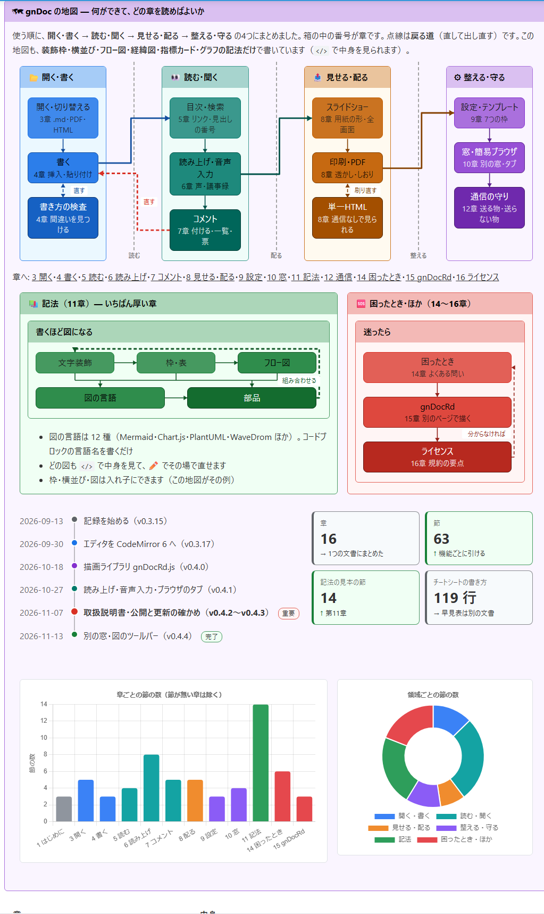
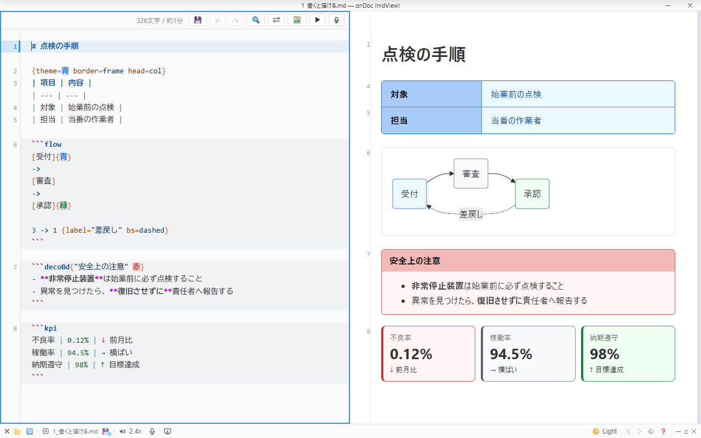
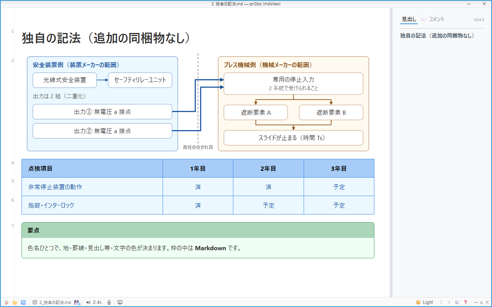
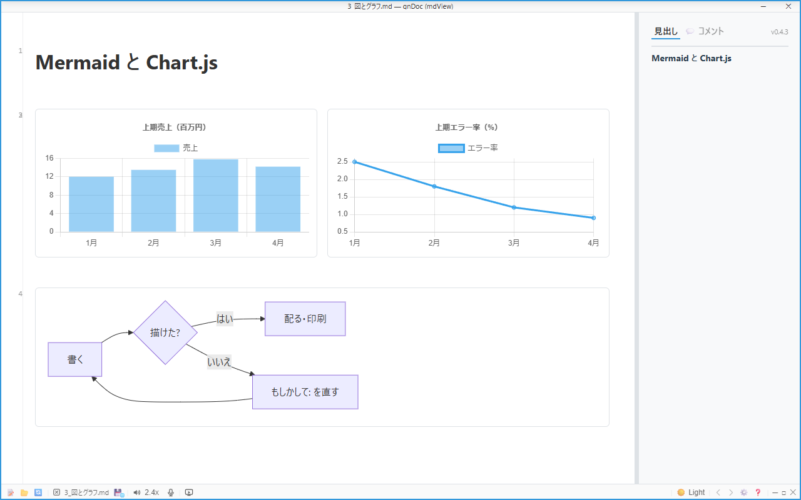
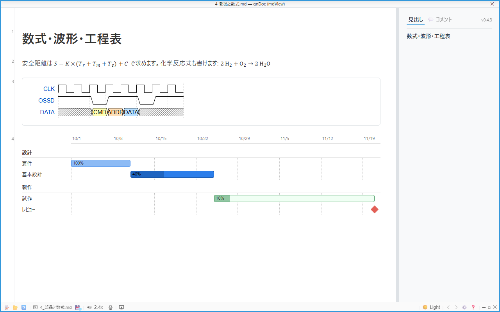
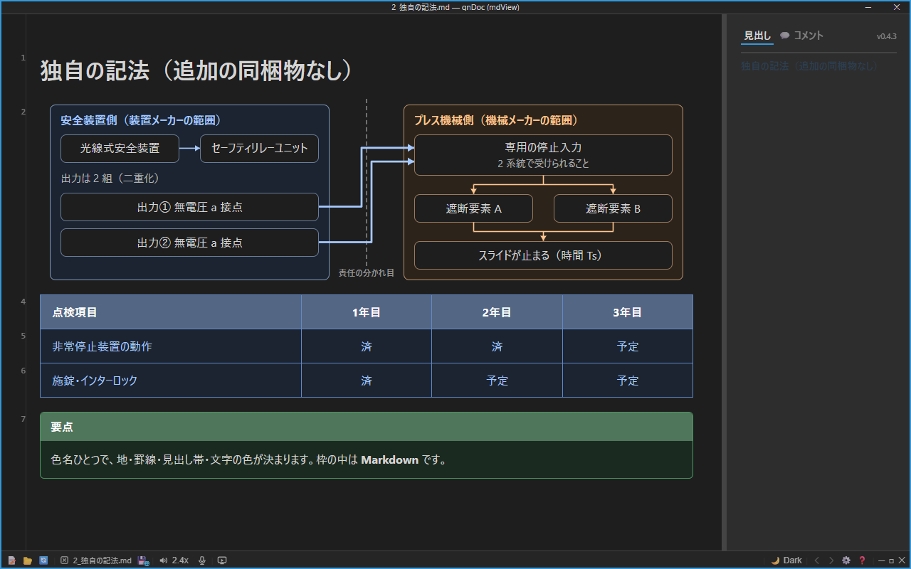
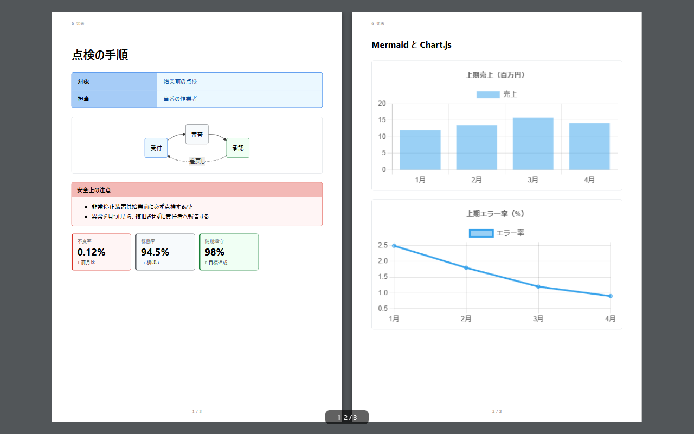

---

# gnDoc (mdView)

> ## 多才な埋込みチャートに対応した Markdown ビュワー
>
> **簡易プレゼン・読み上げ・単一HTMLエクスポート・印刷・簡易編集・オフライン動作を内蔵。**
> コードブロックに言語名を書くだけで、そこに図が描かれます。

* **対象バージョン**: gnDoc (mdView) `v0.4.4l`
* **最終改訂日**: 2026-11-14 JST
* **ライセンス**: 個人・非営利限定ライセンス（[LICENSE.md](LICENSE.md)。`gnDocRd.js`・`gnDocRdLibGen.html` は MIT） / Copyright (c) 2026 take4

### ⚠️ はじめにお読みください

* **本アプリは個人が趣味で作成・公開しているものです。サポート、ご要望への対応、不具合修正の保証は一切ありません**（お問い合わせへの返信もできかねます）。ご自身の責任でご利用ください。
* **初回は `LibGen.html` でオフライン用ライブラリの生成が必要です**（[2. 入手と始め方](#2-入手と始め方)）。
* **`plantuml` / `dbml` / `d2` / `graphviz` の4記法は、既定で図のソースコードを外部サーバー（`kroki.io`）へ送信します。** 外部へ出せない内容では、設定の「🔗 連携」で送信先を自社サーバーへ変えるか、これらの記法を使わないでください。それ以外の描画は外部通信を行いません。通信するすべての機能は [通信の方針](docs/gnDocNetworkPolicy.md) にあります。
* 利用条件は [LICENSE.md](LICENSE.md)（**個人・非営利限定ライセンス**）に従います。個人利用と改変は自由です。再配布は無料かつ受け取り手を把握できる範囲に限られ、**公開の場へのアップロードやミラーの公開は禁止**しています。組織での標準採用や営利利用には事前の許諾が必要です。

---

## 1. gnDoc とは

**gnDoc (mdView)**（ジーエヌ・ドック：旧エムディビュー）は、Windows 用の Markdown ビュワー兼エディタ（`gnDoc.exe`）です。

「Markdown をもっと手軽に、もっと表現豊かに使いたい」という思いから、このソフトウェアの開発を始めました。生成AI時代において Markdown は単なる文書形式ではなく、知識やアイデアを整理・共有する共通言語になりつつあります。本ソフトウェアは、複雑な設定なしでマークダウンと各種チャートを利用できる環境を目指して開発しています。

**設計の軸は「通信経路に依存しないこと」です。** 描画のライブラリをあらかじめローカルに取り込んで読むので、回線の速さ・遮断・配信元の都合に表示が左右されず、外部へ接続しない網の中でも同じように使えます。電子回路設計・シーケンス制御・安全規格の適合仕様書など、技術文書に要る図を揃えています。

**仕組み**: gnDoc の本体は1つの HTML のアプリ（`gnDoc.html`）で、これを [Tauri](https://tauri.app/) で Windows の exe にしています。画面は Windows に入っている WebView2 が描きます。ブラウザのページは手元のファイルを自由に読み書きできないので、文書のあるフォルダの画像や隣の文書の読み込み・保存・上書き前の退避・外での書き換えの見張りは、exe の側が受け持ちます。ページから読めるのは、利用者が開いた文書のフォルダとその下だけです。

> [!NOTE]
> **Windows 版だけです。** Tauri は macOS にも対応しているので、Mac の環境があれば Mac 版を作ること自体はできます。ただ、作者の手元には動作を確かめられる Mac が無く（あるのは古い Intel の Mac 数台と、それより前の機種で、どれも10年以上前の物です。最近は動かしていません）、当面は Mac 版を作る予定はありません。

| 言語名 | 描かれるもの | 描画のしかた |
| --- | --- | --- |
| `flow` | 手順・流れ図（箱とつなぎを行に書くだけ。グリッド配置・枠も可） | オフライン |
| `decoBd` / `cols` | 色付きの装飾枠・カード／列の横並び（中は Markdown） | オフライン |
| `timeline` / `kpi` / `gantt-lite` | 経緯・指標カード・簡易工程表（1行1項目） | オフライン |
| `steps` / `faq` / `progress` / `matrix` | 手順・よくある質問・進み具合・2×2 の表 | オフライン |
| `seq` / `org` | 簡易シーケンス図・組織図 | オフライン |
| `mermaid` | フローチャート／シーケンス／ガント／状態遷移 ほか | オフライン |
| `chartjs` / `csv-chart` | 棒・折れ線・円・レーダー等の統計グラフ | オフライン |
| `wavedrom` / `markmap` / `cytoscape` | 波形・マインドマップ・ネットワーク図 | オフライン |
| `$…$` / `$$…$$` | 数式・化学反応式（KaTeX + mhchem） | オフライン |
| `.pdf`・`.drawio.svg` | PDF の表示・読み上げ／draw.io の図 | オフライン |
| `plantuml` / `dbml` / `d2` / `graphviz` | UML・DB スキーマ・宣言的ダイアグラム・DOT | 外部サーバー（既定 kroki.io） |

### 画面

[](docs/images/gndoc-0-map.png)

*取扱説明書の冒頭の「gnDoc の地図」。画像ではなく、装飾枠・横並び・フロー図・経緯図・指標カード・グラフの**記法だけ**で書いています（[取扱説明書](docs/gnDocManual.md)を gnDoc で開くと、この形で描かれます）*

| | |
| :---: | :---: |
| [](docs/images/gndoc-1-editor-viewer.png) | [](docs/images/gndoc-2-notation.png) |
| 左に書いた Markdown が、右にその場で描かれる | 枠つきのフロー図・色付きの表・装飾枠（追加の同梱物なし） |
| [](docs/images/gndoc-3-mermaid-chart.png) | [](docs/images/gndoc-4-parts-math.png) |
| Chart.js のグラフ（CSV を貼るだけ）と Mermaid | 数式・化学式・WaveDrom の波形・簡易工程表 |
| [](docs/images/gndoc-5-dark.png) | [](docs/images/gndoc-6-slideshow-paper2.png) |
| ダークテーマ（ライト・セピアも） | スライドショー（印刷の紙を2ページずつ並べて見せる） |

**主な機能**

* **読む**: 目次・文書内リンク・見出しの自動番号・図表の拡大と全画面・複数の文書の切り替え・PDF と HTML の表示・**すばやく開く**（`Ctrl+K`。最近読んだ文書・★・留めたフォルダ）・前に読んでいた所から開く・Shift_JIS や UTF-16 の文書も化けずに読み、元の文字コードで保存
* **書く**: エディタ（右クリックの挿入・テンプレート94件・表の貼り付け変換・全文書の検索）・**書き方の検査**（`#見出し`・効かない `**`・表の列のずれ・図や数式の誤りなどを一覧と行の印で知らせる）
* **聞く・話す**: 読み上げ（Windows の声はオフラインで5倍速まで・Azure の自然な声）・音声入力・議事録（決定事項と宿題の抜き出し）
* **見せる・配る**: スライドショー（区切り線ごと・用紙2枚・用紙を上下に分割）・印刷（透かし・しおり付き PDF）・単一HTML の書き出し
* **レビュー**: 文字に付けるコメント（文書の末尾に記録し、本文は書き換えない）・コメント票の書き出しと取り込み
* **AI と使う**: 外で書き換えられた文書を自動で読み直す（AI が書いている文書を横で見守れる）・右クリックで「場所と行」（`資料.md:12-18`）や元の Markdown をコピー（AI に直しを頼むとき）
* **守る**: 上書きの前に前の版を退避（10世代）・外での書き換えの検知・オフラインで動く

---

## 2. 入手と始め方

> [!WARNING]
> **初めて起動すると、Windows が「Windows によって PC が保護されました」（SmartScreen）と警告することがあります。** gnDoc.exe はコード署名をしていないためです。公式リポジトリの Release から取得した物であることを確かめたうえで、「**詳細情報**」→「**実行**」を押してください。Release の説明に載せた SHA-256 と、取得したファイルの値（PowerShell の `Get-FileHash gnDoc.exe`）が同じであることも確かめられます。

1. 公式リポジトリの **Release** から `gnDoc.exe` を取得し、書き込めるフォルダに置きます（`Program Files` の下は避けてください）
2. 起動して「gnDoc 使用許諾」に同意します
3. 画面上部の案内の **「🦉 LibGen.html を開く」** →「生成」で、描画のライブラリ（`gnDocRd-libs.js`・`gnDoc-app-libs.js`）が exe の隣に保存されます（インターネット接続が要るのはこのときだけです）
4. 🔄 再読み込み（`F5`）で図やグラフが描けるようになります

**新しい版**: 起動の後に1日1回だけ、公式リポジトリの版の情報を読み、新しい版があれば下端のバーで知らせます（受け取るだけで、何も送りません）。［更新］を押すと、落として入れ替え、開いていた文書を引き継いで起ち直します。⚙️ →「全般」の 🆕 を外すと、一度も通信しません。

```text
任意のフォルダ/
├── gnDoc.exe             # 本体（取扱説明書・チートシート・サンプル集・LibGen.html を中に持つ）
├── gnDocRd-libs.js       # 描画のライブラリ  ★初回にご自身で生成
└── gnDoc-app-libs.js     # エディタと PDF のライブラリ  ★同上
```

> [!NOTE]
> 2つのライブラリは、第三者のオープンソースライブラリを結合した物なので配布物に含めていません。利用者ご自身が `LibGen.html` で各配布元から取得・生成します。取得する版は gnDoc で試験した版に固定しています。配布物は **`gnDoc.exe` 1本**です。

---

## 3. 付属の文書

| 文書 | 開き方 | 中身 |
| --- | --- | --- |
| **[📖 取扱説明書](docs/gnDocManual.md)** | exe の ❓ →「📖 取扱説明書」 | 操作と記法を機能ごとに引けるリファレンス。困ったときの問いもここ |
| **[⌨️ チートシート](docs/gnDocCheatSheet.md)** | ❓ →「⌨️ チートシート」 | 記法とキーを1枚で引く早見表 |
| **📊 サンプル集** | ❓ →「📊 サンプル集」 | 全記法の動く実例と、業務の題材で組んだ見本（exe の中だけ） |
| **[通信の方針](docs/gnDocNetworkPolicy.md)** | — | いつ・どこへ・何を送るか。送らない物 |
| **[gnDocRd](gnDocRd/README.md)** | — | gnDoc の記法を自分の HTML のページで描く描画ライブラリ（MIT） |

> [!TIP]
> 取扱説明書とチートシートは gnDoc で開くと、図・色・装飾がその場で描かれます。GitHub の画面では、見本の部分が記法のまま見えます。

生成AI（ChatGPT・Claude・Gemini など）に gnDoc 用の文書を書かせるときは、❓ →「🤖 要約仕様」で作った Markdown を AI に渡してから頼んでください。

---

## 4. ライセンス・サポート・報告

* **ライセンス**: 個人・非営利限定ライセンス（[LICENSE.md](LICENSE.md)。オープンソースライセンスではありません）。`gnDocRd.js`・`gnDocRdLibGen.html` は MIT License です。exe に組み込まれた Rust の部品のライセンスは `THIRD-PARTY-NOTICES.txt` にあります
* **紹介するとき**は、ファイルを置くのではなく公式リポジトリ（<https://github.com/take4-commits/gnDoc>）へリンクしてください（配布元を1本に保つため）
* **サポート**: 作者が本業の傍ら趣味で開発しているもので、個別サポート・不具合修正・機能追加の義務を負いません。「現状のまま（As-Is）」の提供です
* **脆弱性の報告**は公開の Issue に書かず、[SECURITY.md](SECURITY.md) の方法でお送りください

要点の一覧は [取扱説明書 第16章](docs/gnDocManual.md#16-ライセンスの要点) にあります。

---

## 5. 改訂履歴

> 本節には**最新の版の変更だけ**を載せます。各版の変更は、公式リポジトリの Release の説明にあります。

### v0.4.4l (2026-11-14)

* 表のスタイルセット（形8 × 配色6・部品・用途8・自分の2〜3色・行と列の繰返し）と、見本から選ぶパネル（`Ctrl+Alt+Y`）を足しました。右クリックのメニューを「いつもの段」と「いまいる所で使える段」に整理し、csv-chart に行ごとの色と縦横の比を足しました
* **表のスタイル**: 表のすぐ上に `{style=帳票 palette=ネイビー}` の1行で、形（フラット・縞・帳票・カード・行カード・比較・見出し帯・項目内容）と配色（モダン・シック・パステル〔既定〕・ネイビー・モノトーン・ミッドナイト）を選べます。文書全体は `<!-- gd-table: … -->` の1行です
* **部品と用途**: `num`（数の列を右寄せ）・`foot`（合計の行）・`badge`（完了・注意などをラベルに）・`no`（番号の列）・`mark=2`（列の強調）・`density=詰める`／`広い`。用途の1語（標準・要約・文章・状態・技術・比べる・高密度・手順）でもまとめて選べます
* **自分の色と繰返し**: `theme=青,橙,緑` で主・副・強調の色を、`rows="青 20%, 無"`・`cols="無, 緑 15%"` で行・列の繰返しの塗りを書けます
* **選択パネル**: 表の中で `Ctrl+Alt+Y`（または右クリックの「🎨 表のスタイル選択…」）。形・用途 × 配色の見本に乗せるとその表で試せ、押すと書きます。`1`〜`8` → `A`〜`F` のキーだけでも選べます
* **右クリックのメニュー**: 上にいつもの項目、区切りの下に「表の中」「選んだ所」などの段を並べます。表の中では表で使える物だけを出し、コードや図の中では挿入の項目を出しません
* **csv-chart**: 見出しが「色」の列で棒・扇形ごとの色を、`ratio: 16:9` で縦横の比を決められます。取扱説明書の冒頭の地図のグラフも csv-chart で書き直しました
* 表のスタイルは濃いテーマでも見やすくし（黒に近い配色の見出しの帯を明るく・線と字を本文の字の色に寄せる）、印刷・PDF では表の1行を頁の途中で割りません
* ビュワーを動かした後にエディタを動かしても、ビュワーが付いてこないことがあったのを直しました（連動で合わせた先が今の位置と同じだと、次の1回が飲まれていた）
