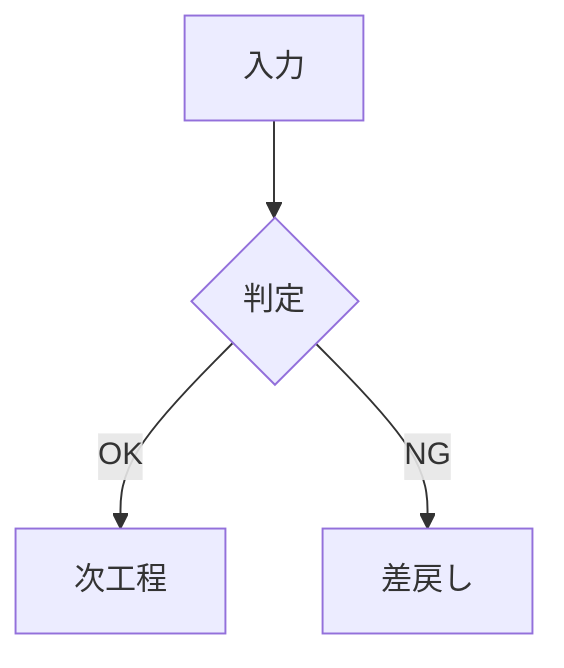

# gnDoc チートシート

**左が書き方、右がその結果**です。詳しい説明と動く実例は「📊 サンプル集」の 2 章（標準の記法）と 3 章（gnDoc 独自の表現）、画面の操作は「📖 ReadMe」の 3 章にあります。

---


## 見出し・段落・改行

| 書き方 | 結果 |
| :--- | :--- |
| `# 文字` 〜 `###### 文字` | 大見出し（H1）〜 H6。**目次に載るのは H1〜H3** |
| 空行 | 段落が変わる |
| 行末に半角スペース 2 つ | そこで改行（空白は見えないので注意） |
| 行末に `\` | 同じく改行。**こちらのほうが確実** |
| `---`（前に空行） | 区切り線。**前の行に文字があると H2 の下線**になる |


## 文字装飾

| 書き方 | 結果 |
| :--- | :--- |
| `**太字**` | **太字** |
| `*斜体*` | *斜体* |
| `~~取消~~` | ~~取消~~ |
| `` `コード` `` | `コード` |
| `==ハイライト==` | ==ハイライト== |
| `++下線++` | ++下線++ |
| `X^2^` | X^2^ |
| `H~2~O` | H~2~O |
| `=={Red:赤}==` ・ `{Red:**太**}` | 装飾は**入れ子**にできます（ハイライト・下線・上付き・下付きの中にも色や太字） |
| `:warning:` / `:警告:` | :warning:（英語名は GitHub と同じ。日本語名でも書ける。`:cry:` `:泣き顔:` → :cry:、`:sob:` `:号泣:` → :sob:、`:sweat_smile:` `:笑い汗:` → :sweat_smile:、`:+2:` → :+2: ほか全28種はサンプル集 2.2.5） |


## 文字色・枠囲み

| 書き方 | 結果 |
| :--- | :--- |
| `{red:文字}` | {red:文字} |
| `{blue:文字}` | {blue:文字} |
| `{dkRed:濃い赤}` | {dkRed:濃い赤} |
| `{ltBlue:淡い青}` | {ltBlue:淡い青} |
| `{dkdkRed:極濃の赤}` | {dkdkRed:極濃の赤} |
| `{ltltBlue:極淡は地に塗る}` | {ltltBlue:極淡は地に塗る} |
| `{#3366cc:任意の色}` | {#3366cc:任意の色} |
| `[[枠囲み]]` | [[枠囲み]] |
| `[[red:色付きの枠]]` | [[red:色付きの枠]] |

色名は `red` `orange` `yellow` `green` `teal` `blue` `purple` `pink` `gray` の9色と、和名の `赤` `橙` `黄` `緑` `青緑` `青` `紫` `桃` `灰`。**この9色は表の配色（`{theme=青}`）でも同じです。**

濃淡は**7段**です。頭に付ける印は1つだけです。

| 段 | 印 | 例 | 和名 | 見え方（赤・青） |
| :--- | :--- | :--- | :--- | :--- |
| 極濃 | `dkdk` | `dkdkRed` | `極濃赤` | {dkdkRed:極濃赤} {dkdkBlue:極濃青} |
| 濃 | `dk` | `dkRed`（`darkRed`） | `濃赤` | {dkRed:濃赤} {dkBlue:濃青} |
| やや濃 | `dklt` | `dkltRed` | `やや濃赤` | {dkltRed:やや濃赤} {dkltBlue:やや濃青} |
| 標準 | なし | `red` | `赤` | {red:赤} {blue:青} |
| やや淡 | `ltdk` | `ltdkRed` | `やや淡赤` | {ltdkRed:やや淡赤} {ltdkBlue:やや淡青} |
| 淡 | `lt` | `ltRed`（`lightRed`） | `淡赤` | {ltRed:淡赤} {ltBlue:淡青} |
| 極淡 | `ltlt` | `ltltRed` | `極淡赤` | {ltltRed:極淡赤} {ltltBlue:極淡青}（地に塗る） |

**極淡は文字ではなく地に塗ります**（いちばん淡い色の文字は白地で読めないため）。`ltltdkBlue` のような重ねは色になりません。
淡い3段（極淡・淡・やや淡）の濃さは、設定パネルの 🎨 のスライダで一緒に濃く・淡くできます（100% が既定）。


## リスト・タスク

```text
- 項目
  - 子項目（半角スペース2つ）
1. 番号つき
   1. 子（半角スペース3つ）
- [x] 済み
- [ ] これから
```

- 項目
  - 子項目（半角スペース2つ）
1. 番号つき
   1. 子（半角スペース3つ）
- [x] 済み
- [ ] これから

タスクは**ビュワー上でクリックするとソースの `[ ]`/`[x]` に反映**されます。


## 表

```text
| 項目 | 中央 | 右寄せ |
| :--- | :---: | ---: |
| 通常 | **太字** | 100 |
```

| 項目 | 中央 | 右寄せ |
| :--- | :---: | ---: |
| 通常 | **太字** | 100 |

`:---` 左寄せ / `:---:` 中央 / `---:` 右寄せ。セル内の縦棒は `\|`、改行は `<br>`。**列数がずれた行は、はみ出したセルが黙って消えます。**

### 表に色を付ける

表の**すぐ上の行**に書きます。**色名ひとつ**で、地・罫線・見出し・文字がまとめて決まります。

```text
{theme=青 border=grid width="50%, 25%, 25%"}
| 点検項目 | 判定 | 実施日 |
| :--- | :---: | ---: |
| 非常停止装置 | 良 | 9/12 |
```

{theme=青 border=grid width="50%, 25%, 25%"}
| 点検項目 | 判定 | 実施日 |
| :--- | :---: | ---: |
| 非常停止装置 | 良 | 9/12 |

`theme=` は文字色と同じ9色（日本語も可）。**濃さも装飾枠と同じ7段で書けます**（`{theme=ltBlue}` `{theme=やや淡赤}` `{theme=濃緑}`）。地がその濃さ、見出し行は1つ濃い段になり、文字は読みやすい側（白か黒）に自動で変わります。色相だけ（`{theme=青}`）と極淡は、淡い地に淡い見出し行です。`border=` は `dashed-row` / `grid` / `clean` / `frame`（角丸の外枠）。`head=col` で1列目を見出しにして見出し行を隠す（`both` は両方）。`line=` は枠線の色。`width=` は列の幅。

```text
{border=frame head=col line=濃黄}
| 項目 | 内容 |
| --- | --- |
| 対象 | 電源投入から監視までの動き |
```

{border=frame head=col line=濃黄}
| 項目 | 内容 |
| --- | --- |
| 対象 | 電源投入から監視までの動き |


## 引用・注記・折りたたみ

```text
> 引用
> > 入れ子の引用

<details>
<summary>クリックで開く</summary>

隠しておきたい内容

</details>
```

> 引用
> > 入れ子の引用

<details>
<summary>クリックで開く</summary>

隠しておきたい内容

</details>

GitHub と同じ**注記**も書けます。1行目に印だけを書きます（`NOTE` `TIP` `IMPORTANT` `WARNING` `CAUTION`）。

```text
> [!WARNING]
> 電源を切ってから作業すること
```

> [!WARNING]
> 電源を切ってから作業すること


## コードブロック

エディタで行頭に ```` ``` ```` と打つと、**使える言語名の候補**が説明つきで出ます（`↑` `↓` で選んで `Enter`、`Esc` で閉じる）。

| 書き方 | 効果 |
| :--- | :--- |
| ```` ```js ```` | 言語を指定して色分け（**大文字小文字を区別**） |
| ```` ```js:src/main.js ```` | 上にファイル名のタブが付く |
| ```` ```js {1,3-5} ```` | その行を強調（行番号も自動で付く） |
| ```` ```js showLineNumbers ```` | 行番号を付ける |
| ```` ```js {1} noLineNumbers ```` | 強調はするが行番号は出さない |

```js:src/main.js {2}
const a = 1;
const b = 2;   // この行が強調される
```


## リンク・画像

| 書き方 | 結果 |
| :--- | :--- |
| `[表示文字](https://example.com)` | [表示文字](https://example.com) |
| `<https://example.com>` | <https://example.com> |
| `[](#見出し)` | 文字の無いリンクは、行き先の見出しの名前（番号を付けていれば「1.2 見出し」）で描く。`[](#fig-2)` は「図 2」 |
| `[設計書](設計書.md#節)` | 隣の文書を一覧に足して開き、その節へ（◀ で戻る。ブラウザ版は 📁 の関連付けが要る） |
| URL をそのまま書く | 自動でリンクになる |
| `` | 画像（フォルダを関連付ければファイル名だけでも可） |
| `<PB>` / `<div class="page-break"></div>` | 改ページ。印刷でそこから次の頁（画面では点線） |
| `<!-- gd-numbering: 1.1 H2 -->` | 見出しの番号（その文書だけ。行の頭に書く。`1.1`／`1.1.`／`第1章`・`H1`／`H2` から。設定の § より優先。`なし` で付けない） |
| `<!-- gd-watermark: 社外秘 敷き詰め 背面 15% 大きさ150% -->` | 印刷の透かし（その文書だけ。行の頭に書く。設定の 💧 より優先。`なし` で付けない）。文字・`中央`/`敷き詰め`・`前面`/`背面`・濃さ%・大きさ%・色（灰・赤・青） |
| `<gd-cm n="1">文字</gd-cm><sup id="gd-cm-ref-1">[1](#gd-cm-1)</sup>` | コメントの印（v0.4.1b〜d の gnDoc が本文に入れた形。v0.4.1e からは本文に入れず、末尾の「💬 コメント」の章だけ。開くとその形へ直す）。線と番号が付き、重ねると末尾の `<a id="gd-cm-1"></a>` の項目が出る。`done` を付けると解決済み（灰色の点線） |
| `` | HTMLタグ形式の画像。相対パス解決は `` と同じ。`width`等の属性が使える |
| `` | draw.io の図。**「draw.io と編集可能な SVG」で書き出す**と、図表の枠（折りたたみ・拡大・全画面・画像として保存・ソース表示）が付きます |

| 書き方 | 移動先 |
| :--- | :--- |
| `[戻る](#リンク画像)` | 見出し「リンク・画像」へ（見出しの文字を小文字にし、記号を落とし、空白を `-` にしたもの。GitHub と同じ） |
| `[2つ目へ](#注意-1)` | 同じ見出しが複数あるとき、2つ目の「注意」へ（3つ目は `-2`） |

見出しへの移動は目次（`Ctrl+T`）からもできます。


## 数式・化学式

```text
文中に $P = V \cdot I$ と書けます。

$$ S = K \times (T_r + T_m + T_c) + C_{kr} $$

$\ce{2H2 + O2 -> 2H2O}$
```

文中に $P = V \cdot I$ と書けます。

$$ S = K \times (T_r + T_m + T_c) + C_{kr} $$

$\ce{2H2 + O2 -> 2H2O}$

> **金額。** `$100 と $200` のような金額は数式にしません（閉じの `$` の直前が空白・直後が数字なら数式にしない）。数式は `$x$` のように `$` の内側に空白を付けずに書きます。迷ったら金額は `\$100`。


## 寄せ（左・中央・右）

Markdown に寄せの記法は無いので HTML を直接書きます。**開始タグの後と終了タグの前に空行**を入れると、中でも Markdown が使えます。

```text
<div style="text-align:center">

**中央寄せ**の段落

</div>
```

<div style="text-align:center">

**中央寄せ**の段落

</div>


## 装飾枠・カード

注意書きや要点を、色の付いた枠で囲みます。**書くのは色名ひとつ**です。

````text
```decoBd{title="安全上の注意" theme=赤}
- **非常停止装置**は毎日点検すること
- 施錠の確認を怠らないこと
```
````

```decoBd{title="安全上の注意" theme=赤}
- **非常停止装置**は毎日点検すること
- 施錠の確認を怠らないこと
```

色名だけでも書けます: `` ```decoBd {緑} `` ／ `` ```decoBd {green title="要点"} ``。

**`title=` と `theme=` は省けます**: 題を半角の `"…"` で囲み、色名を空白かカンマで並べます。

````text
```decoBd{"安全上の注意" 赤}
```decoBd{"安全上の注意", 赤}
````

題は**半角の引用符**（`"…"` か `'…'`）で囲みます（全角の `”…”` や `「…」` は題になりません）。色を2つ書くと**後の方**が効きます。`{}` は省けません。

`title=` を省くと見出し帯なしの枠に、`theme=` を省くと灰色になります。**枠の中は Markdown として読まれます**（箇条書き・太字・表・リンクが使えます）。

**題にも文字装飾が使えます**: `` ```decoBd{"見解 **重要** {Red:注意}" 青} ``。題に `` `コード` `` を入れるときは、枠を `~~~` で囲みます（`` ``` `` の1行目にはバッククォートを書けない決まりです。書くと枠ごと崩れます）:

````text
~~~decoBd{"`npm install` の注意" 黄}
本文
~~~
````

**濃さも書けます**（7段）: `` ```decoBd{"注意" ltdkRed} `` ／ `` ```decoBd{theme=濃赤} ``。地がその濃さになり、帯と枠線は1つ濃い段、文字は読みやすい側（白か黒）に自動で変わります。色相だけ（`{赤}`）と極淡（`{ltltRed}`）は淡い地に淡い帯です。


## フロー図

箱を `[…]`、つなぎを `->` `<-` `<->` `-` で書きます。**太線**は `=>` `<=` `<=>` `==`。`↓` `↑` `↕`（太は `⇓` `⇑` `⇕`）も同じ意味で使えます。

**箱・枠の題・中身の行・線のラベル（`{label="…"}`）・仕切りの文字には、本文と同じ文字装飾が使えます**（`[① **確認** {Red:必須}]{ltRed}`・`2 -> 1 {label="差戻し {Red:**要**}"}`）。枠つきのフロー図の線のラベルだけは、装飾を外した文字で描きます。

````text
```flow
[受付]{青}
->
[審査]
->
[承認]{緑}

3 -> 1 {label="差戻し" bs=dashed}
```
````

```flow
[受付]{青}
->
[審査]
->
[承認]{緑}

3 -> 1 {label="差戻し" bs=dashed}
```

戻り線は**箱の番号**で書きます（`3 -> 1`）。`label=` で見出し、`bs=dashed` で破線。`` ```flow{dir=縦} `` で縦並びになります。印刷は紙の幅いっぱい（小さい図は元の大きさのまま・縦長は頁の高さに合わせる）で、`` ```flow{print=60%} `` で幅を指定できます（図の枠ごとその幅。どの図のフェンスにも書けます）。

箱の `{…}` には**色と形**を、カンマで区切って順不同で書きます。何も書かなければ**角丸**です。

| 書き方 | 箱 |
| :--- | :--- |
| `[処理]` / `[処理]{■}` | 角丸（既定） |
| `[処理]{□}` | 角の立つ四角 |
| `[判定]{◇}` | 菱形 |
| `[開始]{○}` | 円 |
| `[注意]{△}` / `{▽}` | 三角 / 逆三角 |
| `[処理]{青}` / `{ltltBlue}` | 淡い地に色の枠 |
| `[処理]{ltBlue}` / `{ltdkBlue}` / `{dkltBlue}` / `{dkBlue}` / `{dkdkBlue}` | その濃さの地（文字の色は読みやすい側に自動で変わる） |
| `[判定]{黄,◇}` | 色と形を両方 |

箱の行のすぐ下へ続けて書くと、**その箱の中身**になります（行ごとに改行され、`-` は中黒になります）。

````text
```flow
[取り込み]{青}
- .md / .txt をドロップ
->
[書き出し]{緑}
- 単一 HTML / 印刷
```
````

```flow
[取り込み]{青}
- .md / .txt をドロップ
->
[書き出し]{緑}
- 単一 HTML / 印刷
```

### フロー図のグリッド配置

`|` で箱を横に並べ、`---` の行で次の段へ移ります。**各段は図の全幅で、段の中は等分**です（段ごとに箱の数が違っても左右の端がそろいます）。線はすべて書いたとおりに引き、**箱の番号**（左上から1・2・3…）か**箱の見出し**で指します。

````text
```flow
[受付]{青} | [確認]{緑}
---
[保管] | [完了]{橙,○}

1 <-> 2
1 ↓ 3
2 => 4 {label="主経路"}
```
````

```flow
[受付]{青} | [確認]{緑}
---
[保管] | [完了]{橙,○}

1 <-> 2
1 ↓ 3
2 => 4 {label="主経路"}
```

引ける線は**同じ段の隣どうし**と**上下に隣り合う段どうし**です。それ以外は図の下に「引けなかった線」として出ます。

**グリッドの箱に中身を書く**: 中身のある箱は**1行に1つずつ**書き、すぐ下の行に中身を続けます。**同じ段の次の箱は行頭を `|`** にします。

````text
```flow
[受付]{青}
- 受付しました。
- 番号を振る
| [確認]{緑}
- 内容を確認
---
[保管] | [完了]{橙,○}

1 <-> 2
1 ↓ 3
```
````

```flow
[受付]{青}
- 受付しました。
- 番号を振る
| [確認]{緑}
- 内容を確認
---
[保管] | [完了]{橙,○}

1 <-> 2
1 ↓ 3
```

**箱を並べた行の下に、表のように `|` で列を分けて書くこともできます**（v0.3.17t）。`|` の数で何列目の箱の中身かが決まり、空の欄は飛ばします（2列目だけなら `| 内容`、3列目だけなら `| | 内容`）。`|` の無い行は1列目の箱へ入ります。上の「1行に1つずつ」と同じ図の中で混ぜても構いません（`|` の後が `[` なら次の箱、文字なら中身）。

````text
```flow
[書類]{ltBlue} | [動作]{ltGreen} | [電気]{ltTeal}
回路図 | 自動・手動 | 電圧
| 手順書 | - 絶縁
---
[油圧]{ltPurple} | [寸法・作業]{ltYellow} | [停止性能・段取り]{ltPink}
油圧回路 | | 停止距離

1 -> 2
2 -> 3
3 ↓ 6
6 <- 5
5 <- 4
```
````

```flow
[書類]{ltBlue} | [動作]{ltGreen} | [電気]{ltTeal}
回路図 | 自動・手動 | 電圧
| 手順書 | - 絶縁
---
[油圧]{ltPurple} | [寸法・作業]{ltYellow} | [停止性能・段取り]{ltPink}
油圧回路 | | 停止距離

1 -> 2
2 -> 3
3 ↓ 6
6 <- 5
5 <- 4
```

箱より多い欄は図の下に「読めなかった欄」として出ます。`|` のある行は、`->` を含んでいても線として読みません。

### 枠つきのフロー図（枠・仕切り・枠をまたぐ線）

`[[名前]]{色}` が枠、`- - - 文字 - - -` が点線の仕切りです。枠の中は1行が1段で、`→` でつなぎ、`|` で並べ、`↓` だけの行で上下をつなぎます。**枠をまたぐ線は仕切りのすぐ下に `元 ⇒ 先`**（名前は頭の言葉だけ）。

````text
```flow
[[安全装置側（装置メーカーの範囲）]]{青}
[光線式安全装置] → [セーフティリレーユニット]

出力は 2 組（二重化）
[出力① 無電圧 a 接点]
[出力② 無電圧 a 接点]

- - - 責任の分かれ目 - - -
出力① ⇒ 専用の停止入力
出力② ⇒ 専用の停止入力

[[プレス機械側（機械メーカーの範囲）]]{橙}
[専用の停止入力]
2 系統で受けられること
↓
[遮断要素 A] | [遮断要素 B]
↓
[スライドが止まる（時間 Ts）]
```
````

```flow
[[安全装置側（装置メーカーの範囲）]]{青}
[光線式安全装置] → [セーフティリレーユニット]

出力は 2 組（二重化）
[出力① 無電圧 a 接点]
[出力② 無電圧 a 接点]

- - - 責任の分かれ目 - - -
出力① ⇒ 専用の停止入力
出力② ⇒ 専用の停止入力

[[プレス機械側（機械メーカーの範囲）]]{橙}
[専用の停止入力]
2 系統で受けられること
↓
[遮断要素 A] | [遮断要素 B]
↓
[スライドが止まる（時間 Ts）]
```

| 書き方 | 意味 |
| :--- | :--- |
| `[[名前]]{青, 40%}` | 枠（色・幅）。`{枠なし}` で線も地も無い枠 |
| 枠を続けて書く／`---` | 横に並ぶ／次の段へ |
| `- - - 文字 - - -` | 点線の仕切り。`- - - ⇒ 文字 - - -` で隣の枠への太矢印 |
| 箱のすぐ下の行／空行の後の行 | 箱の中身／枠に書く説明文 |
| `元 ⇒ 先` | 箱の名前で引く線（頭の言葉でよい） |
| `枠の名前:箱の名前` | 別の枠の箱を指す（`：` も可・`A班:2` で番号） |
| `{"見出し" 点線}` | 線の見出しと点線 |
| `{"見出し" 赤}` | 線の色（矢じり・見出しも同じ色。`color=赤` も可。これまでの flow の戻り線・グリッドの線でも使えます） |

### 横並び（`cols`）

同じ書き方で、**列（中身は Markdown）を横に並べます**。仕切りの下の線で、列の中の図の箱どうしもつなげます。列の中の区切り線は `***`。

`````text
````cols
[[安全装置側]]{青}
```flow
[光線式安全装置] → [セーフティリレーユニット]
[出力①]
[出力②]
```
- 遅動時間 Tl は装置メーカーが保証します

- - - 責任の分かれ目 - - -
出力① ⇒ 専用の停止入力
出力② ⇒ 専用の停止入力

[[プレス機械側]]{橙}
```flow
[専用の停止入力]
↓
[スライドが止まる]
```
- 止まるまでの時間 Ts は実測が必要
````
`````

````cols
[[安全装置側]]{青}
```flow
[光線式安全装置] → [セーフティリレーユニット]
[出力①]
[出力②]
```
- 遅動時間 Tl は装置メーカーが保証します

- - - 責任の分かれ目 - - -
出力① ⇒ 専用の停止入力
出力② ⇒ 専用の停止入力

[[プレス機械側]]{橙}
```flow
[専用の停止入力]
↓
[スライドが止まる]
```
- 止まるまでの時間 Ts は実測が必要
````

ほかの図と同じく 📋・`</>`・✏️ が使え、**🖼 / ⬇** で文字も線も入った SVG としてコピー・保存できます（Word・PowerPoint などで使えます）。

### 枠の中に図・横並び（入れ子）

装飾枠の中にも `flow`・`cols`・表・部品をそのまま書けます。**外側のバッククォートを、中のフェンスより1つ多く**します（枠の中に `cols`、その中に `flow` なら外側は5つ）。数えたくないときは外側を `~~~` で囲みます。`cols` の列の中に装飾枠を置くこともできます。実例は 📊 サンプル集の 3.7 節。

`````text
````decoBd{"⚠ 異常を見つけたとき" 赤}
迷ったら**止める**が先です。

```flow
[異常を見つけた]{赤,△} | [自分で止められる？]{黄,◇}
---
[非常停止を押す]{dkRed} | [班長へ連絡]{橙}

1 -> 2
2 ↓ 3 {"はい" 赤}
2 ↓ 4 {"いいえ"}
```
````
`````

````decoBd{"⚠ 異常を見つけたとき" 赤}
迷ったら**止める**が先です。

```flow
[異常を見つけた]{赤,△} | [自分で止められる？]{黄,◇}
---
[非常停止を押す]{dkRed} | [班長へ連絡]{橙}

1 -> 2
2 ↓ 3 {"はい" 赤}
2 ↓ 4 {"いいえ"}
```
````


## 部品（経緯・指標カード・簡易工程表）

どれも **1行に1項目、列は `|` で区切ります**。`#` で始まる行は注記、読めない行は図の下に「読めなかった行」として出ます。

````text
```timeline
2024-01 | 要件定義開始
2024-03 | 試作完了 | 里程碑
2025-01 | 改訂 v2 | 重要
```
````

```timeline
2024-01 | 要件定義開始
2024-03 | 試作完了 | 里程碑
2025-01 | 改訂 v2 | 重要
```

````text
```kpi
不良率 | 0.12% | ↓ 前月比
稼働率 | 94.5% | → 横ばい
納期遵守 | 98% | ↑ 目標達成
```
````

```kpi
不良率 | 0.12% | ↓ 前月比
稼働率 | 94.5% | → 横ばい
納期遵守 | 98% | ↑ 目標達成
```

````text
```gantt-lite
設計
要件 | 2026-10-01 | 2026-10-10 | 青 | 100%
基本設計 | 2026-10-11 | 2w | 青 | 40%
製作
試作 | 2026-10-25 | 2026-11-20 | 緑 | 10%
レビュー | 2026-11-21 | ◆ | 赤
```
````

```gantt-lite
設計
要件 | 2026-10-01 | 2026-10-10 | 青 | 100%
基本設計 | 2026-10-11 | 2w | 青 | 40%
製作
試作 | 2026-10-25 | 2026-11-20 | 緑 | 10%
レビュー | 2026-11-21 | ◆ | 赤
```

| 部品 | 列 | 決まった語・印 |
| :--- | :--- | :--- |
| `timeline` | 時点 \| 出来事 \| 修飾 | `里程碑`（菱形・青）・`重要`（赤）・`注意`（橙）・`完了`（緑）。色名ならその色 |
| `kpi` | 名称 \| 値 \| トレンド | 先頭の矢印で色: ↑緑・↓赤・→灰 |
| `gantt-lite` | 作業 \| 開始 \| 終了 \| 色・進捗 | 終了に `5d` `2w` `3m`、`◆` で里程標。`\|` の無い行は区分の見出し |
| `steps` | 手順 \| 注記 | 注記が `注意:` `警告:` なら橙、`完了条件:` `確認:` なら緑 |
| `faq` | `Q:` 問い / `A:` 答え | 答えは次の `Q:` まで（Markdown）。画面では閉じる・印刷では開く |
| `progress` | 項目 \| 0〜100 \| 色 | 色を書かない棒は灰。`\|` の無い行は区分の見出し |
| `matrix{swot}` | キー行 `S` `W` `O` `T`（`S,色` `S \| 項目` も可）の下に1行1項目 | 既定の地は S 緑・W 橙・O 青・T 赤 |
| `matrix{priority}` | キー行 `高/高` `高/低` `低/高` `低/低`（重要度/緊急度）の下に1行1項目 | `すぐやる` `計画する` `任せる` `減らす` でも可 |
| `seq` | A → B: 内容 \| 非同期 | `→` 実線・`⇢` `-->` 破線・`←` 逆向き。Mermaid に直して描く |
| `org` | 字下げで階層（`名前 \| 補足`） | 上から下の組織図。Mermaid に直して描く |

## 図を描く

コードブロックの言語名を書くだけで図になります。並びは **gnDoc 独自の記法 → 同梱ライブラリで描く図 → 外部サーバーで描く図**の順です。

| 言語名 | 描かれるもの | 描画 |
| :--- | :--- | :--- |
| `flow` | 手順・流れ図（上の「フロー図」） | オフライン |
| `decoBd` | 装飾枠（上の「装飾枠・カード」） | 追加の同梱物なし |
| `cols` | 列を横に並べる（上の「横並び」） | 追加の同梱物なし |
| `timeline` / `kpi` / `gantt-lite` | 経緯・指標カード・簡易工程表（上の「部品」） | 追加の同梱物なし |
| `steps` / `faq` / `progress` / `matrix{swot}` / `matrix{priority}` | 手順・よくある質問・進み具合・2×2 の表（上の「部品」） | 追加の同梱物なし |
| `seq` / `org` | 簡易シーケンス図・組織図（上の「部品」） | オフライン |
| `mermaid` | フローチャート／シーケンス／ガント ほか | オフライン |
| `csv-chart` | 表を貼るだけのグラフ | オフライン |
| `chartjs` | Chart.js の JSON をそのまま | オフライン |
| `wavedrom` | デジタル波形・タイミングチャート | オフライン |
| `markmap` | マインドマップ | オフライン |
| `cytoscape` | ネットワーク・グラフ図 | オフライン |
| `plantuml` | UML | **外部サーバー** |
| `dbml` | データベーススキーマ図 | **外部サーバー** |
| `d2` | 宣言的ダイアグラム | **外部サーバー** |
| `graphviz`（`dot`） | DOT 記法のグラフ | **外部サーバー** |

**外部サーバー**の 4 つは既定で `kroki.io` へ送信します。外部へ出せない内容や通信が制限された環境では、設定パネル右端の 🔌 で自社サーバーを指定するか、使用を避けてください。

図の直前に `図: 説明` と単独行で書くと、下に「図 1: 説明」と自動採番されます（`表:` と書いても表示は「図」です）。

### Mermaid で使える種類

`flowchart` / `sequenceDiagram` / `classDiagram` / `stateDiagram-v2` / `erDiagram` / `gantt` / `journey` / `pie` / `gitGraph` / `mindmap` / `timeline` / `quadrantChart` / `requirementDiagram` / `sankey-beta` / `xychart-beta`



### WaveDrom

```wavedrom
{signal:[{name:'clk',wave:'P....'},{name:'dat',wave:'x.34x',data:['A','B']}]}
```

### csv-chart（Excel の表をそのまま貼る）

```csv-chart
type: bar
title: 月別の実績
---
月, 件数
4月, 42
5月, 38
6月, 51
```

### PlantUML で使える種類

`Sequence` / `Activity` / `Class` / `Component` / `Deployment` / `UseCase` / `State` / `Timing` / `MindMap` / `WBS` / `Salt` / `C4`（**外部サーバー**で描きます）

---


## ショートカット

| キー | 動作 |
| :--- | :--- |
| `Ctrl+S` | Markdown として保存 |
| `Ctrl+E` | エディタを開く／閉じる |
| `Ctrl+T` | 目次を開く／閉じる（上の「見出し」「💬 コメント」で一覧を切り替え。閉じているときは右端の札から開けます。**右上の版番号をクリックすると取扱説明書が開きます**） |
| `Ctrl+F` | ビュワー内検索（ビュワーを一度クリックしてから。エディタ側ではエディタ内検索） |
| `Ctrl+O` / `Ctrl+W` | 開く／いまの文書を閉じる |
| `F5` / `Ctrl+R` | 再読み込み（開いている文書は編集中の内容ごと戻る） |
| `Ctrl+P` | 印刷 |
| `Ctrl+,` | 設定パネル |
| `Ctrl+Z` / `Ctrl+Y` | 元に戻す／やり直す |
| マウスの戻る／進むボタン | 表示履歴を戻る／進む（ステータスバーの ◀ ▶ でも可）。**目次・文書内リンク・全文書検索で飛んだ場所**を戻れます（ファイル一覧からの手の切替は入りません） |
| `Alt+↑` / `Alt+↓` | 開いている文書を切り替え（**エディタの中では行の移動**） |
| `Alt+Shift+↑` / `Alt+Shift+↓` | 最初／最後の文書へ（**エディタの中では行の複製**） |
| `Alt+PageUp` / `Alt+PageDown` | 開いている文書を切り替え（エディタの中でも） |
| `Alt+1`〜`9` | 一覧の n 番目の文書へ |
| `Alt+←` / `Alt+→` | 表示履歴の戻る／進む（エディタの中でも） |
| `Ctrl+Alt+T` / `Ctrl+Alt+Shift+T` | テーマ系統（ライト／ダーク／セピア）／テーマのスタイル |
| `Ctrl+↑` / `Ctrl+↓`・`Ctrl`＋ホイール | **ビュワーの文字の大きさ**（`Ctrl+0` で 100%）。読み上げ中は速さ・スライドショーは大きさ・PDF は拡大。エディタの中では効かない |
| `Ctrl+Tab` / `Ctrl+Shift+Tab` | 設定を開いている間、設定のタブの次／前 |
| `Esc` | 開いているものを閉じる。何も無ければ読み上げを終了 |

> **近道のキーの決まり**（v0.4.1j で整理。標準／VS Code の切り替えはやめました）: `Alt`＝**移動**（`←` `→` は時間の前後、`↑` `↓` は並びの上下）、`Ctrl`＝**量**（`↑` `↓` で大きさ・速さ）、`Shift`＝**同じ物のもう1つの性質**、見た目（テーマ）は `Ctrl+Alt`＋文字。エディタの中の `Alt+↑↓`／`Alt+Shift+↑↓` は VS Code と同じです。

### エディタで

| 操作 | 動作 |
| :--- | :--- |
| `/`（行頭） | 挿入メニュー（見出し・タスク・図・グラフ・画像・表・テンプレート） |
| ```` ``` ````（行頭） | 言語名の候補（`↑` `↓` で選んで `Enter`。閉じの ```` ``` ```` まで入る） |
| `Ctrl+.` / `Shift+F10` | 右クリックメニューをキャレットの位置に（番号キーで選べる） |
| 文字を選んでマウスを離す | 装飾パレット（太字・文字色・濃淡・枠囲み ほか） |
| 右クリック | 選択中は装飾、未選択は挿入メニュー |
| エディタ上部の `🖼️` / 右クリック `🖼️ 画像` / `/` の「画像を選んで参照」 | 画像を選んで `` を挿入。**文字を選んでから実行すると代替テキストになります** |
| 右クリック `画像を埋め込む（Base64）` | 画像を本文に焼き込みます。1ファイルで持ち運べる代わりに**本文が数十万文字ふくらみます** |
| `Tab` / `Shift+Tab` | テンプレートを挿した直後は次／前の直す場所へ。それ以外は複数行のインデント／アウトデント |
| 右クリックのテンプレートに乗せる | 挿す前の仕上がりが横に出る（`/template` の選び窓も） |
| `Ctrl+Alt+C` | 選択行をタスクリストに |
| `Ctrl+Shift+F` | カーソルのある表の桁を揃える（全角は2桁） |
| `Ctrl+F` / `Ctrl+H` | エディタ内の検索／置換（📚 で全文書を横断） |
| `Ctrl+Shift+V` | 表や画像に変換せずに貼る |

### ビュワーで

| 操作 | 動作 |
| :--- | :--- |
| トリプルクリック | その位置から読み上げ開始（文字を選んでからなら、選んだ文字の位置から）。一時停止中は、読んでいた段落で再開・別の段落ならそこから |
| 読み上げ中にダブルクリック | 一時停止（リンク・ボタン・コメントの印は除く。図の上は全画面のまま） |
| 読み上げ中に `Ctrl`＋`↑` `↓` | 読む速さを1段上げる／下げる |
| 読み上げ中に `Ctrl`＋`Shift`＋`↑` `↓` | 音声を前／次へ |
| ⚙️ の「音声」のタブ | 読み上げの声の一覧（☁ Azure → 🌐 WebView2 → 💻 Windows。💻 は exe だけで、オフラインでも5倍まで）。ネットの声（Azure AI Speech）は自然な声・5倍までの早口（キーと地域を入れる。文章を Microsoft へ送る） |
| ダブルクリック（単語） | 単語を選択（エディタ側にも同期） |
| 図表 右上 `−` `＋` `⊙` `⤢` | 縮小／拡大／リセット／全画面（`Ctrl+ホイール`でも可） |
| 図表の上でダブルクリック | 全画面（全画面の中でもう一度ダブルクリック・`Esc` で閉じる） |
| 図表 右上 `</>` | ソースをその場に表示 |
| 図表 右上 `✏️` | その場で編集（`Ctrl+Enter` で適用、`Esc` で取消） |
| 図表 右上 `⬇` / `📋` | 画像として保存／ソースをコピー |
| 下端のバーを `Alt`＋ダブルクリック | 簡易ブラウザ（文書の中の外部リンクもここで開く） |
| 簡易ブラウザの `Ctrl+T` / `Ctrl+W` / `Ctrl+Tab` / `Ctrl+L` | **タブ**（v0.4.1o。新しいタブ・いまのタブを閉じる・切り替え〔`Shift` で逆〕・アドレスバーへ）。上端の帯に並ぶ。閉じている間の `Ctrl+T`・`Ctrl+W` は本体のまま（目次・文書を閉じる） |
| 簡易ブラウザの − 100% ＋ / `Ctrl+−` `Ctrl+＋` `Ctrl+0` | ページの文字の大きさ（ブラウザ版。倍率はタブごと。exe はページの中の `Ctrl`＋ホイール） |
| 文書のリンクを `Ctrl`＋クリック / 中ボタン | 簡易ブラウザの裏の新しいタブで開く（`Ctrl+Shift`＋クリックは前に出す） |
| 図表 左上 `⌄` | 折りたたむ |
| `Ctrl+Alt+Shift+D` / 右クリックの「🎙 議事録」 | **議事録**（新しい議事録の文書に、話を時刻と話者付きで書き足す。議事録の間は `Ctrl+1`〜`9` で話者） |
| `Ctrl+Alt+Shift+S` / 右クリックの「📝 議事録をまとめる」 | **議事録のまとめ**（記録から決定事項・宿題を抜き出す〔言い回しと `【決定】` `【宿題】`。この PC の中で〕。設定で使うと決めれば ☁ Azure AI Language の要約も） |
| 🎙 / `Ctrl+Alt+D` / エディタの右クリック | **音声入力**（話すとカーソルの所に文字が入る。もう一度・`Esc` で止める。☁ Azure → 🌐 WebView2〔ブラウザ〕の音声認識。声は外へ送られる） |
| 文字を選んで 💬 / 右クリック / `Ctrl+Alt+M` | **コメントを付ける**（文書のファイルの中に記録する〔本文の印＋末尾の章〕。エディタの本文には入らない。本文は文書と同じ記法。書く欄で文字を選ぶと装飾パレット） |
| コメントの線に重ねる／押す | 中身を見る／留める（留めて ↩ 返信・✔ 解決・✏️ 直す・🗑 消す。`Esc` で閉じる） |

### PDF を開いているとき

`.pdf` をドロップすると、そのまま表示・読み上げできます。しおりは目次になります。ページ送りと拡大縮小は右上のツールバー（`Ctrl+ホイール`でも可）。**PDF は編集・保存・単一HTML書き出し・スライドショーの対象外**です。
