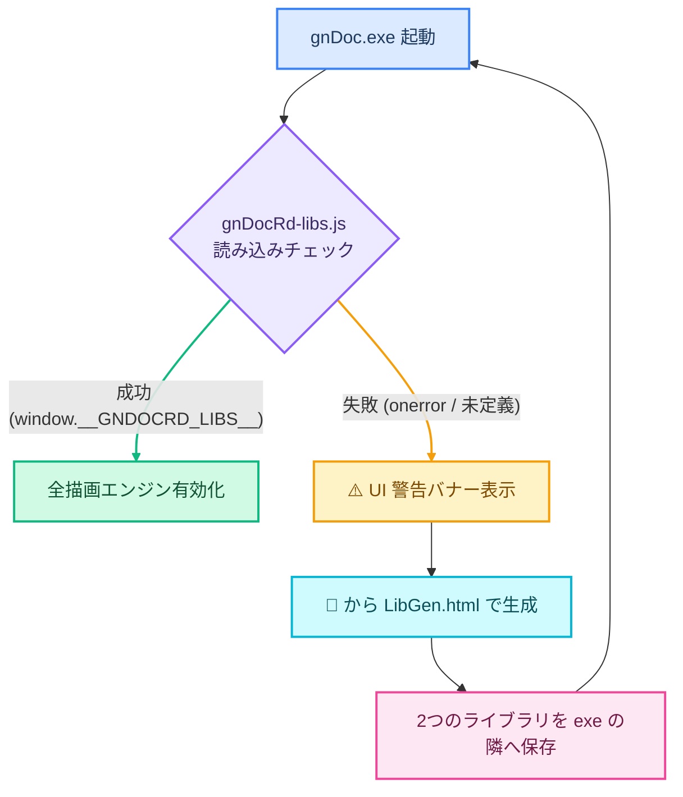
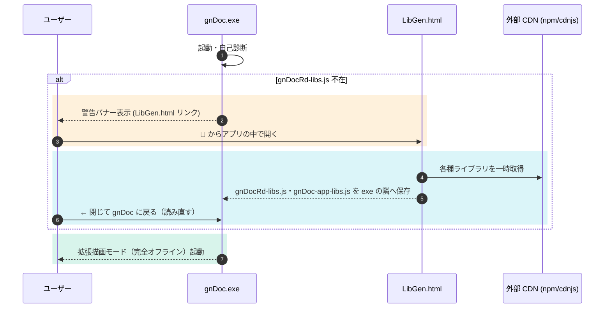
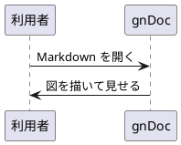

# gnDoc 取扱説明書

> [!TIP]
> **本書は gnDoc で開くと、図・色・装飾がその場で描かれます**（❓ →「📖 取扱説明書」）。GitHub の画面では、すぐ下の「gnDoc の地図」や第11章の見本などが記法のまま見えます（地図を描いた姿は [README](../README.md) の画面の写しで見られます）。

gnDoc (mdView) の操作と記法を、機能ごとに引けるようにまとめた説明書です。入手と概要は [README](../README.md)、記法の早見表は [チートシート](gnDocCheatSheet.md)、利用条件は [LICENSE.md](../LICENSE.md) にあります。

``````decoBd{"🗺 gnDoc の地図 — 何ができて、どの章を読めばよいか" 紫}
使う順に、**開く・書く → 読む・聞く → 見せる・配る → 整える・守る** の4つにまとめました。箱の中の番号が章です。点線は**戻る道**（直して出し直す）です。この地図も、**装飾枠・横並び・フロー図・経緯図・指標カード・グラフの記法だけ**で書いています（`</>` で中身を見られます）。

````cols
[[📂 開く・書く]]{青}
```flow
[開く・切り替える]{ltBlue}
- 3章 .md・PDF・HTML
↓
[書く]{ltdkBlue}
- 4章 挿入・貼り付け
↕ {"直す" 点線}
[書き方の検査]{dkltBlue}
- 4章 間違いを見つける
```

- - - 読む - - -
書く ⇒ 目次・検索
コメント ⇒ 書く {"直す" 点線 赤}

[[👀 読む・聞く]]{青緑}
```flow
[目次・検索]{ltTeal}
- 5章 リンク・見出しの番号
↓
[読み上げ・音声入力]{ltdkTeal}
- 6章 声・議事録
↓
[コメント]{dkltTeal}
- 7章 付ける・一覧・票
```

- - - 配る - - -
読み上げ ⇒ スライドショー

[[📤 見せる・配る]]{橙}
```flow
[スライドショー]{ltOrange}
- 8章 用紙の形・全画面
↓
[印刷・PDF]{ltdkOrange}
- 8章 透かし・しおり
↕ {"刷り直す" 点線}
[単一HTML]{dkltOrange}
- 8章 通信なしで見られる
```

- - - 整える - - -
印刷 ⇒ 設定・テンプレート

[[⚙ 整える・守る]]{紫}
```flow
[設定・テンプレート]{ltPurple}
- 9章 7つの枠
↓
[窓・簡易ブラウザ]{ltdkPurple}
- 10章 別の窓・タブ
↓
[通信の守り]{dkltPurple}
- 12章 送る物・送らない物
```

````

章へ: [3 開く](#3-文書を開く切り替える)・[4 書く](#4-書くエディタ)・[5 読む](#5-読む)・[6 読み上げ](#6-読み上げ音声入力議事録)・[7 コメント](#7-コメント)・[8 見せる・配る](#8-見せる配る)・[9 設定](#9-設定)・[10 窓](#10-窓簡易ブラウザ起動)・[11 記法](#11-記法のリファレンス)・[12 通信](#12-通信とセキュリティ)・[14 困ったとき](#14-困ったとき)・[15 gnDocRd](#15-描画ライブラリ-gndocrdjs)・[16 ライセンス](#16-ライセンスの要点)

`````cols
[[📚 記法（11章）— いちばん厚い章]]{緑, 62%}
````decoBd{"書くほど図になる" 緑}
```flow
[文字装飾]{ltGreen} → [枠・表]{ltGreen} → [フロー図]{ltdkGreen}
↓
[図の言語]{ltdkGreen} → [部品]{dkltGreen}

部品 ⇒ 文字装飾 {"組み合わせる" 点線}
```
````
- 図の言語は 12 種（Mermaid・Chart.js・PlantUML・WaveDrom ほか）。コードブロックの言語名を書くだけ
- どの図も `</>` で中身を見て、✏️ でその場で直せます
- 枠・横並び・図は入れ子にできます（この地図がその例）

[[🆘 困ったとき・ほか（14〜16章）]]{赤}
````decoBd{"迷ったら" 赤}
```flow
[困ったとき]{ltRed}
- 14章 よくある問い
↓
[gnDocRd]{ltdkRed}
- 15章 別のページで描く
↓
[ライセンス]{dkltRed}
- 16章 規約の要点

3 -> 1 {label="分からなければ" bs=dashed}
```
````
`````

````cols
[[🕒 これまでの歩み]]{枠なし, 55%}
```timeline
2026-09-13 | 記録を始める（v0.3.15） | 灰
2026-09-30 | エディタを CodeMirror 6 へ（v0.3.17） | 青
2026-10-18 | 描画ライブラリ gnDocRd.js（v0.4.0） | 紫
2026-10-27 | 読み上げ・音声入力・ブラウザのタブ（v0.4.1） | 青緑
2026-11-07 | 取扱説明書・公開と更新の確かめ（v0.4.2〜v0.4.3） | 重要
2026-11-13 | 別の窓・図のツールバー（v0.4.4） | 完了
```

[[📏 数で見る]]{枠なし}
```kpi
章 | 16 | → 1つの文書にまとめた
節 | 63 | ↑ 機能ごとに引ける
記法の見本の節 | 14 | ↑ 第11章
チートシートの書き方 | 119 行 | → 早見表は別の文書
```
````

````cols
[[📊 章ごとの節の数（地図の色で）]]{枠なし, 60%}
```csv-chart
type: bar
title: 章ごとの節の数（節が無い章は除く）
ylabel: 節の数
legend: none
ratio: 1.7
---
章, 節の数, 色
1 はじめに, 3, 灰
3 開く, 5, 青
4 書く, 3, 青
5 読む, 4, 青緑
6 読み上げ, 8, 青緑
7 コメント, 5, 青緑
8 配る, 5, 橙
9 設定, 3, 紫
10 窓, 4, 紫
11 記法, 14, 緑
14 困ったとき, 6, 赤
15 gnDocRd, 3, 赤
```

[[🍩 領域ごと]]{枠なし}
```csv-chart
type: doughnut
title: 領域ごとの節の数
legend: bottom
ratio: 1.1
---
領域, 節の数, 色
開く・書く, 8, 青
読む・聞く, 17, 青緑
見せる・配る, 5, 橙
整える・守る, 7, 紫
記法, 14, 緑
困ったとき・ほか, 12, 赤
```
````
``````

| 章 | 中身 |
| --- | --- |
| 1. はじめに | 付属の文書・配布物と置き方・初めての起動 |
| 2. 画面の構成 | 各部の名前と役目 |
| 3. 文書を開く・切り替える | 開ける形式・切り替え・表示履歴・控え |
| 4. 書く（エディタ） | 挿入・貼り付け・整える・保存・書き方の検査 |
| 5. 読む | 目次・リンク・見出しの番号・検索・見た目・図表の操作・右クリック |
| 6. 読み上げ・音声入力・議事録 | 声・読む物・Azure・聞き取り・議事録のまとめ |
| 7. コメント | 付ける・一覧・票・印刷への出し方 |
| 8. 見せる・配る | スライドショー・印刷・透かし・PDF・単一HTML |
| 9. 設定 | 7つの枠・テンプレート・メニューの整理・書き出し |
| 10. 窓・簡易ブラウザ・起動 | 窓の扱い・タブ・HTML の扱い・新しい版の確かめ |
| 11. 記法のリファレンス | gnDoc 独自の記法と、図を描く記法の見本 |
| 12. 通信とセキュリティ | 外へ送る物・送らない物・守り |
| 13. 組み込みのライブラリ | 生成する2つのファイルの中身 |
| 14. 困ったとき | よくある問い |
| 15. 描画ライブラリ gnDocRd.js | 別のページで gnDoc の記法を描く |
| 16. ライセンスの要点 | 利用規約の要約・サポート・報告 |

---

## 1. はじめに

### 1.1 付属の文書

どれも ❓ ヘルプの上部のボタンから開けます。開いている文書は一覧に残るので、`Alt`＋`↑` `↓` で戻れます。

| 文書 | 開き方 | 向いている用途 |
| --- | --- | --- |
| **📖 取扱説明書**（本書） | ❓ →「📖 取扱説明書」、または目次の右上の版番号 | 操作と記法を機能ごとに引く |
| **⌨️ チートシート** | ❓ →「⌨️ チートシート」 | 記法とキーを1枚で引く早見表（左が書き方、右が結果） |
| **📊 サンプル集** | ❓ →「📊 サンプル集」 | 全記法の動く実例と、業務の題材で組んだ見本。図の元のコードは `</>` で見られます |
| **🤖 要約仕様** | ❓ →「🤖 要約仕様」 | 生成AI（ChatGPT・Claude・Gemini など）に gnDoc 用の文書を書かせるときに渡す資料 |

**🤖 要約仕様**は、版番号・使い方・最新の記法・独自の記法の完成例をまとめた Markdown をクリップボードに入れ、続けてファイル（`gnDoc_要約仕様_版.md`）にも保存します。これを AI に添付するか貼り付けてから、書いてほしい内容を頼みます。gnDoc を新しくしたら作り直してください。

### 1.2 配布物と置き方

```text
任意のフォルダ/
├── gnDoc.exe             # 本体（本書・チートシート・サンプル集・LibGen.html を中に持つ） ← 配布物
├── gnDocRd-libs.js       # 描画のライブラリ（marked・Mermaid・KaTeX ほか）  ★初回にご自身で生成（exe の中から作れます）
└── gnDoc-app-libs.js     # エディタと PDF のライブラリ（CodeMirror 6・PDF.js）  ★同上（一緒に作られます）
```

* **exe と同じフォルダに2つのファイルを置く**だけで動きます。以前の版で作った1本の `combined-libs.js` も、新しい2つが無いあいだは読みます（作り直せば、そちらは使われなくなります）
* **2つのファイルは配布物に含まれていません。** Mermaid や KaTeX など多数の第三者オープンソースライブラリを結合したファイルで、それぞれの著作権は各権利者に帰属します（ファイルの先頭に、含まれるライブラリとライセンスの一覧が書かれます）。作者がこれを再配布する形を避けるため、**利用者ご自身が `LibGen.html` で各配布元から取得・生成する方式**です。生成は初回の一度だけです
* **取得する版は、gnDoc で試験した版に固定しています**（作り直すたびに違う版が入って見た目が変わる、ということは起きません）。新しい版が出ていれば、生成のあとにログでお知らせします
* 描画のライブラリ（`gnDocRd-libs.js`）は、描画ライブラリ **gnDocRd**（`gnDocRd.js`。[第15章](#15-描画ライブラリ-gndocrdjs)）と共通の物です
* gnDoc の配布物は **`gnDoc.exe` 1本**です（公式リポジトリの Release から取得します）。**Windows 用だけ**で、Mac 版は当面予定していません（理由は README の「仕組み」）。本書の中で「ブラウザ版」と書いてある所は、作者が開発と試験に使っているブラウザで開く形の話で、配布はしていません

### 1.3 初めての起動

> [!WARNING]
> **初めて起動すると、Windows が「Windows によって PC が保護されました」（SmartScreen）と警告することがあります。** gnDoc.exe はコード署名をしていないためです。公式リポジトリの Release から取得した物であることを確かめたうえで、「**詳細情報**」→「**実行**」を押してください。Release の説明に載せた SHA-256 と、取得したファイルの値（PowerShell の `Get-FileHash gnDoc.exe`）が同じであることも確かめられます。

1. `gnDoc.exe` を起動します。初めて起動したときは「**gnDoc 使用許諾**」が出ます（無保証・免責の要点。全文は利用規約）。「同意して使う」で始まり、「同意しない」では終了します
2. ライブラリがまだ無ければ、画面上部に案内が出ます。**「🦉 LibGen.html を開く」**を押すと、アプリの中で `LibGen.html` が開きます
3. 「生成」を押すと、2つのファイルが **exe と同じフォルダへ直接保存されます**（インターネット接続が要るのはこのときだけです）。保存したら 🔄 再読み込み（`F5`）で図やグラフが描けるようになります

| 状態 | どうなるか |
| --- | --- |
| `gnDocRd-libs.js` が無い | 文書が表示されません（Markdown を変換する `marked` も、この中に入っているため） |
| `gnDoc-app-libs.js` だけが無い | 文書は表示でき、エディタと PDF が使えません（📝 を押すと案内が出ます） |
| exe が `Program Files` の下にある | 書き込みを拒否されることがあります。exe ごと書き込めるフォルダへ移してください |

どの場合もクラッシュはせず、生成して再読み込みすれば通常どおり使えます。

---

## 2. 画面の構成

| 場所 | 中身 |
| --- | --- |
| **中央** | ビュワー（描かれた文書）。エディタを開くと左に並びます |
| **右** | 目次（見出し一覧）。コメントのある文書では下にコメント一覧も出し、間のバーで高さを変えます。`Ctrl+T` で開閉し、閉じているときは右端の札から開けます。右上の版番号を押すと本書が開きます |
| **下端のバー（ステータスバー）** | 左から 📝 エディタ・📂 開く・🔄 再読み込み ｜ ✕ 閉じる・ファイル名・💾🌐 単一HTML ｜ 🔊 読み上げ・速度・残り時間 ｜ スライドショー ｜ テーマ ｜ ◀ ▶ 表示履歴・⚙️ 設定・❓ ヘルプ ｜ ─ □ ✕ |
| **ファイル名** | マウスを乗せると、開いている文書の一覧が出ます。一覧の行に乗せると、そのファイルのサイズと更新日時が出ます。行の右クリックの「📂 エクスプローラーで表示」で、フォルダを開いてそのファイルを選んだ状態にできます。ダブルクリックでファイル名をコピー |
| **⚙️ 設定** | マウスを乗せる・押す・`Ctrl+,` で開きます（[第9章](#9-設定)） |

キーの一覧は ❓ ヘルプと ⌨️ チートシートにもまとまっています。

---

## 3. 文書を開く・切り替える

| 操作 | 方法 | 補足 |
| --- | --- | --- |
| 開く | ウィンドウへ**ドラッグ＆ドロップ**・📂・`Ctrl+O` | `.md` `.markdown` `.txt` `.pdf` `.html` を開けます。複数を一度に落とすと、先頭を表示して残りは一覧に積みます |
| すばやく開く | `Ctrl+K`・ファイル一覧の 🔎 | 名前で絞り込んで開きます（[3.4](#34-すばやく開くctrlk)） |
| 何でもテキストとして読む | `Alt` を押しながら落とす | 対応表に無い拡張子でも、コードとして色分けして開きます（バイナリは読みません） |
| 切り替える | ファイル名にマウスを乗せて一覧から選ぶ・`Alt`＋`↑` `↓`・`Alt`＋`1`〜`9` | `Alt`＋`Shift`＋`↑` `↓` で最初／最後 |
| 閉じる | 一覧の左端の ✕・`Ctrl+W` | |
| 表示履歴 | ◀ ▶・マウスの戻る／進むボタン・`Alt`＋`←` `→` | 目次・文書内リンク・全文書検索で飛んだ場所を戻れます。ファイル一覧からの手の切替や、文書を開く・閉じるは履歴に入りません |

### 3.1 形式ごとの扱い

| 形式 | 扱い |
| --- | --- |
| **PDF** | そのまま表示し、読み上げもできます。しおりは目次になります。ページ送りと拡大縮小は右上のツールバー（`Ctrl`＋ホイールでも可）。編集・保存・単一HTML書き出し・スライドショーの対象外です |
| **HTML** | ブラウザで開いたときと同じ見た目で、独立した枠の中に表示します（中のスクリプトは gnDoc 本体へは届きません）。Markdown を埋め込んだ HTML の扱いは [10.3](#103-html-の扱い) |
| **画像** | 開いた `.md` の隣からの相対パスで出ます |
| **文字コード** | UTF-8 のほか、**Shift_JIS・UTF-16・BOM 付きの UTF-8** も見分けて読みます（古い `.txt` も化けません）。保存は**元の文字コードのまま**です。Shift_JIS で表せない文字（絵文字など）を書いて保存すると、UTF-8 に変えて保存するか尋ねます。ファイル一覧の行にマウスを乗せると、UTF-8 以外なら文字コードが出ます |

### 3.2 控えと外での書き換え

* **自動の控え**: 開いている文書と編集中の内容は、アプリの保存領域（WebView2）に控えます。🔄 や `F5` で読み込み直しても続きから開きます（PDF は数MBあるため控えません）
* **読んでいた位置**: 文書ごとに、最後に読んでいた所（PDF は頁）と読んだ日時を控えます。閉じた文書を開き直したとき・起動し直したときは、**前に読んでいた所から**表示します（新しい順に200件まで。この PC の gnDoc の中にだけ控えます）。⚙️ →「全般」の 📖 を外すと、いつも先頭から開きます
* **外で書き換えられたとき**: 開いているファイルを別のエディタ・他の人・AI のエージェントなどが更新すると、次のようにします。どちらも、見ていた場所はそのまま保ちます

  | 文書 | どうなるか |
  | --- | --- |
  | 編集していない | **尋ねずに読み直します**（gnDoc を見ていないときも。数秒ごとに見ます）。AI が書いている文書を、横に開いて見守れます |
  | 編集中 | gnDoc へ戻ったときに、**読み直すかどうか尋ねます**（読み直すと編集中の内容は失われます） |

  ⚙️ →「全般」の 🔄 を外すと、編集していない文書も尋ねるようになります

* **上書き前の退避**（exe）: 💾・`Ctrl+S` で上書きするとき、前の中身をアプリの保存領域へ控えます（文書ごとに新しい方から10世代。中身が変わらないときは控えません）。ビュワーの右クリックの「🕘 退避した版」から選ぶと、**新しい文書（未保存）**として開きます（元のファイルは書き換えません）。⚙️ →「編集」の 🗂️ で止められます。文書のフォルダには何も作りません

### 3.3 文書のリンク

* 本文の `[設計書](設計書.md)` を押すと、その文書を一覧に足して開きます（一覧にあれば切り替えるだけ。`設計書.md#節` ならその節へ）。◀ で元の場所へ戻れます
* exe は文書のフォルダから読みます。ブラウザ版は設定の 📁 で関連付けたフォルダから読み、そこの下の段の文書（`sub/a.md`）の中のリンクと画像は、その文書の場所が基準です（`../` で1段上）

### 3.4 すばやく開く（Ctrl+K）

`Ctrl+K`（またはファイル一覧の 🔎）で窓が開きます。名前を打つと絞り込み、`↑` `↓` で選んで `Enter` で開きます。`Esc` か、もう一度 `Ctrl+K` で閉じます。

| 欄 | 中身 |
| --- | --- |
| 📚 開いている文書 | 一覧にある文書。選ぶと切り替えます |
| ★ 星付き（exe） | ★を付けた文書。行の ☆ か `Ctrl+D` で付け外しします |
| 🕘 最近読んだ文書（exe） | 閉じた文書を、読んだ日（今日・昨日・日付）ごとに新しい順で。開くと前に読んでいた所から表示します |
| 📁 留めたフォルダ（exe） | 窓の下の「📁 フォルダを留める…」で選んだフォルダの中の文書（4段下まで・`.` で始まるフォルダは除く）。見出しの ✕ で留めるのをやめます |
| ⌘ コマンド | 名前を打ったときだけ並びます。`>` で始めるとコマンドだけ（例 `>保存`） |

* 空白で区切ると、どの語も含む物に絞ります（例 `設計 2026`）。フォルダの文書は、フォルダからの場所でも引けます
* ブラウザ版は「開いている文書」と「コマンド」だけです（ファイルの場所を知らないので、閉じた文書を開き直せません）

---

### 3.5 文書を別の窓へ（exe）

ファイルの一覧（ステータスバーのファイル名に乗せると出る一覧）の行を、**Ctrl を押しながら窓の外へドラッグ**して離すと、その文書が新しい窓に移ります。行の右クリックの「🪟 別の窓で開く」でも移せます。**ステータスバーのファイル名**を Ctrl を押しながらドラッグしても、表示中の文書を同じように移せます。

* **戻す**: 別の窓の行を、Ctrl を押しながら元の窓の上へドラッグして離します（右クリックの「⇤ 元の窓へ戻す」でも）。ほかの別の窓の上で離すと、その窓へ移ります。最後の1つを戻すと、別の窓は閉じます
* 別の窓でも、ほかの文書を開けます。同じ文書は2つの窓で同時に開きません（開こうとすると、開いている窓を前に出します）
* **別の窓を閉じる**と、その窓の文書も閉じます。未保存の変更のある文書があれば、閉じる前に尋ねて元の窓へ戻します
* 新しい窓は、マウスを離した所に開きます。別の窓の位置と大きさは覚えません。元の窓を閉じると別の窓も閉じ、次に起動したとき、その文書は元の窓の一覧に戻ります
* 設定（テーマなど）はどの窓も同じです。片方で変えた設定は、もう片方では次に開いたときに効きます
* PDF は移せません（ファイルをその窓へ落としてください）
* **組み込みブラウザのタブ**も、**Ctrl を押しながら**タブをドラッグして窓の外で離すと別の窓へ移ります。ほかの窓の**題名の帯（タブの並び）の上**で離すと、その窓の離した所（タブとタブの間・並びの右の空き）に入ります。引いている間、入る所に縦の線が出ます。ページや本文の上で離したときは統合せず、その場所に別の窓として出ます（タブ1枚だけの別の窓なら、窓ごと動きます）。見ていたページはそのまま移ります（履歴・スクロール・入力中の欄）。Ctrl を押さずにタブをドラッグすると、題名バーと同じく窓全体が動きます。タブの並べ替えは、Ctrl を押しながらドラッグして、その窓のタブの並びの上で離します

## 4. 書く（エディタ）

| 操作 | 方法 | 補足 |
| --- | --- | --- |
| 開く・閉じる | 📝・`Ctrl+E` | ビュワーと左右に並び、スクロールと選択が左右で連動します。間の仕切りはドラッグで動かせます |
| 新しい文書 | `Ctrl` を押しながら 📝 | 空のエディタとビュワー。保存すると保存先を尋ねます |
| 保存 | `Ctrl+S`・エディタ上部の 💾 | **開いたファイルへそのまま上書き**し、新規の文書は保存先を尋ねます。改行コード（CRLF / LF）は元のファイルのまま書きます。exe は上書きの前に前の版を控えます（[3.2](#32-控えと外での書き換え)） |
| 元に戻す | `Ctrl+Z` / `Ctrl+Y` | 文書ごとに 64 段 |
| 探す・置き換える | `Ctrl+F`・置換は `Ctrl+H` | 大文字小文字・正規表現・**📚 全文書を横断**して探せます（置換はいまの文書だけ） |
| 表の桁を揃える | `Ctrl+Shift+F` | カーソルのある表。全角を2桁で数え、寄せの指定は残します |
| 表のスタイルを選ぶ | `Ctrl+Alt+Y` | カーソルのある表で、形（または用途）8 × 配色6 の見本のパネルを開きます。`1`〜`8` で形、`A`〜`F` で配色（押すと書きます）。`Tab` で形と用途を切り替えます |
| 字下げ | `Tab` / `Shift+Tab` | 複数行 |
| タスクにする | `Ctrl+Alt+C` | 選択行 |
| 図やコードをその場で直す | ビュワーの図表・コードブロックの右上 ✏️ | `Ctrl+Enter` で本文へ書き戻します |
| 画像を落とす | エディタの上へ画像ファイルを落とす | 落とした場所へ `` を挿入します。文書と同じフォルダか、その配下の画像に限ります |

**右の画面への反映**: 打鍵が 0.5 秒止まると反映します。句読点・改行などの切れ目では 0.2 秒、書き続けていても 3 秒に一度は追いつきます（設定の ⏱️ で変えられます）。

### 4.1 挿入

| 入口 | 出る物 |
| --- | --- |
| **右クリック**（`Ctrl+.`・`Shift+F10`・`Menu` キーでも） | 文字を選んでいれば装飾（太字・文字色・枠・リンク・行の変換 ほか）。選んでいなければ**7つの組**（✏️ 文字・段落／📊 表／🖼️ 画像・コード／📐 図・グラフ／😀 絵文字／🧮 数式・化学式／📄 文書の型。完成例は94件）。図・グラフは さらに 枠・フロー図／グラフ・工程／Mermaid／PlantUML・その他 に分かれます。gnDoc 独自の記法は右端にキーワードが出ます。番号キーで選べます。**場所で出す物が変わります**: 表の中では行の中に入る物だけと、区切りの下に表の項目（📊 表の段）。コードや図の中では挿入の組を出しません。行の途中で見出し・図などを選ぶと、その行の後ろへ入れます |
| **行頭で `/`** | よく使う挿入のメニュー（見出し・タスク・Mermaid・グラフ・画像・表・テンプレート） |
| **行頭で ```` ``` ````** | 使える言語名の候補が一行の説明つきで出ます（`fl` → `flow` のように絞り込み、`Enter` で閉じの ```` ``` ```` まで入ります） |
| **文字を選んでマウスを離す** | 装飾パレット（太字・斜体・ハイライト・下線・上下付き・コード・リンク・ファイル参照・参照リンク／文字色9色×濃淡5段／枠囲み） |

* **テンプレートの仕上がりを見る**: 右クリックのテンプレートにマウスを乗せる（↑↓ で選ぶ）と、**挿す前の仕上がり**が横に出ます（`/template` の選び窓も同じ）
* **直す場所を送る**: 挿すと最初の直す場所が選ばれ、**`Tab` で次**、`Shift+Tab` で前へ戻ります（まだ回っていない場所には点線の枠）。最後はテンプレートの末尾へ移って終わります（`Esc` やテンプレートの外へ動いても終わります）
* **その場所で使えない物は灰色**になり、乗せると理由が出ます（右クリックメニューも同じ）
* **言語名の打ち間違い**（```` ```mermiad ````）は、ビュワーのそのブロックの上に「**もしかして: mermaid**」が出ます。押すとソースのフェンスが直ります

### 4.2 貼り付け

* Excel や Web の表は **Markdown の表に変換**して貼ります（`Ctrl+Shift+V` で変換せずに貼る）
* 画像は本文の末尾に参照定義として入ります

### 4.3 書き方の検査

書いたつもりと表示が食い違う所を見つけると、下端のバーに **⚠ 件数** が出ます（無ければ出ません）。押すと一覧が開き、行を押すとビュワーのその場所へ移って光ります（エディタを開いていれば、その行へも移ります）。エディタでは、見つかった行の左の縁に印が付きます。生成AIが書いた文書の見直しにも使えます。

| 種類 | 見つける物 |
| --- | --- |
| 見出し | `#見出し` のように `#` の後に空白が無く、見出しにならない行（`#1` のような番号は見ない） |
| 表 | 見出しの行と列の数が違う行（多い分は捨てられ、少ない分は空になる） |
| コード | 閉じていないコードの囲み（文書の終わりまでがコードになる） |
| 強調 | 効かずに文字のまま出ている `**`・`__`（閉じ忘れ・前後の空白・記号との並び） |
| リンク | 行き先の見出しが無い文書内リンク |
| 脚注 | 定義（`[^1]: 本文`）の無い `[^1]` |
| 言語名 | 打ち間違えた言語名（「もしかして」が出ている物） |
| 図 | flow や部品の「読めなかった行」「引けなかった線」、Mermaid などの描画の誤り |
| 数式 | 組めない数式 |
| 画像 | 読めない画像 |
| HTML | 安全のために取り除いた HTML（`<script>` など） |

書くたびに少し待ってから見直します（図は少し遅れて描かれるため）。内蔵の資料・PDF・HTML は見ません。`Esc` か外を押すと一覧が閉じます。

---

## 5. 読む

| 機能 | 操作 | 説明 |
| --- | --- | --- |
| 目次 | `Ctrl+T` | 項目を押すとその見出しへ移り、エディタを開いていればソースの行へも移ります。閉じているときは、ビュワーの右端の真ん中に小さな札（☰ 見出し・💬 件数）が出て、押すとその一覧が開きます（ブラウザ版は `Ctrl+T` がブラウザに取られるので、札から開きます） |
| ビュワー内検索 | ビュワーを一度クリックしてから `Ctrl+F` | `Enter` / `Shift+Enter` で次／前 |
| 文字の大きさ | `Ctrl`＋`↑` `↓`・文章の上で `Ctrl`＋ホイール | `Ctrl`＋`0` で 100% |
| テーマ | `Ctrl`＋`Alt`＋`T`（`Shift` も押すとスタイル） | ライト・ダーク・セピアの3系統と、それぞれのスタイル |
| 行番号・画像の眩しさ・折りたたみ | 🔢・🌗・⊞ ⊟ | 🌗 はダーク系で画像の眩しさを抑えます。⊞ ⊟ は折りたたみの一括開閉 |

**コメントのある文書の目次**: 上に見出し一覧・下にコメント一覧を両方出します。間のバーをドラッグすると高さが変わり、覚えます（ダブルクリックで半分ずつ）。文書を開くたびに見出し一覧から始まり、コメントが無ければ見出し一覧だけです。上の「💬 コメント」で、その文書の間だけ出す・隠すを替えられます。

### 5.1 文書内リンク

* `[…](#見出しの文字)` で見出しへ飛べます（GitHub と同じ付け方。同じ見出しが複数あれば `#見出し-1` で2つ目）
* **文字を書かずに `[](#見出し)`** とすると、行き先の見出しの名前（番号を付けていれば「4.2.1 見出し」）で描きます。図なら `[](#fig-2)` で「図 2」。章を動かしても描くたびに引き直します
* 行き先が無ければ赤い波線で知らせます

### 5.2 見出しの番号

* 設定の § で、見出しに番号（`1.1`・`1.1.`・`第1章`）を付けます（既定は付けない）
* 「H2 から」にすると、文書の題の H1 には付きません。目次・🖨・単一HTMLにも同じ番号が出ます
* 文書ごとに変えるときは、文書の中に（行の頭から）`<!-- gd-numbering: 1.1 H2 -->` と書きます（`なし` でその文書だけ付けない）
* 同梱の資料（本書など）は番号を手で書いてあるので付けません

### 5.3 図表の操作

| 操作 | 方法 |
| --- | --- |
| 縮小・拡大・戻す・全画面 | 右上の `−` `＋` `⊙` `⤢`。初期表示に戻すのは ⊙ |
| 全画面 | **図の上でダブルクリック**（Chart.js・Markmap・Cytoscape・flow・部品も。最初から窓の幅いっぱいの大きさで出ます）。全画面の中でもう一度ダブルクリック（または `Esc`）で閉じます |
| ソース・コピー・保存 | `</>` でソース（```` ``` ```` の開きの行から閉じまで。言語名の後ろの `{…}` も見て直せます）、📋 でコピー、⬇ で画像として保存 |
| 折りたたみ | 左上の ⌄ |

図表は種類を問わず共通で、**キャプション自動採番／折りたたみ／ソース表示／その場で編集／画像として保存／拡大（Ctrl+ホイール）／全画面表示**に対応します。

装飾枠（`decoBd`）にマウスを乗せると、枠の右上の外に 📋 </> ✏️ が出ます。`decoBd{…}` の行から閉じまで（中の横並び・図ごと）を、図と同じ窓で見て直せます。入れ子の枠では、いちばん外側の枠が対象です。

### 5.4 ビュワーの右クリック

メニューは、上に**いつも出る項目**、区切りの下に**右クリックした所で使える項目**（小さな見出しつき）の順に並びます。いつも出る項目は、どこで開いても同じ位置・同じ番号です。

| 段 | 項目 | 中身 |
| --- | --- | --- |
| いつも | 📍 場所をコピー | 選んだ所（選んでいなければ右クリックした所）の、文書の場所と行を `C:\…\資料.md:12-18` の形でコピーします（ブラウザ版は名前だけ）。AI に「ここを直して」と頼むときに貼れます |
| いつも | 🔍 この部分のソースを表示 | 同じ行の範囲の元の Markdown を、図の </> と同じ窓に出します。📋 でコピー、✏️ でその場で直せます。装飾枠の中で右クリックすると、`decoBd{…}` の行から閉じまで（入れ子の横並び・図ごと）が出ます |
| いつも | 📝 Markdown でコピー | 同じ行の範囲の、元の Markdown をそのままコピーします |
| いつも | 🖨️ 印刷 | [8.2](#82-印刷) |
| いつも | 🖨️ 印刷：透かし有り | 設定の「透かしを刷る」が外れていても、その1回だけ透かしを刷ります |
| いつも | 💾 新規保存（名前を付けて保存） | 保存の窓で場所と名前を選び、以後はそのファイルに上書き |
| いつも | 📂 エクスプローラーで表示 | exe だけ |
| いつも | 🕘 退避した版 ▸ | exe だけ。上書きの前に控えた版の一覧（[3.2](#32-控えと外での書き換え)） |
| いつも | 🖥️ 表示 ▸ | テーマ・目次・エディタ・行番号・コードの色分け・画像の眩しさ・見出しの番号・表の既定の形・折りたたみ・スライドショー。設定パネルの「表示」と同じ値 |
| 🔊 読み上げ中 | ⏸ ⏹・速さ・声・読む物 | 読み上げている間だけ（[6.2](#62-右クリックで読む)） |
| 選んだ所 | 💬 コメントを付ける・📋 コピー・🔊 読む・📖 読み方を登録 | 文字を選んでいるとき |
| 見出し | 🔊 この節を読む・ここから最後まで読む | 見出しの上で右クリックしたとき |
| 📊 表 | ▦ 表をコピー ▸・🎨 表のスタイル選択…・スタイル（形）▸・スタイルの配色 ▸ | 表の上で右クリックしたとき。コピーは Markdown（元の行）・CSV・TSV（Excel に貼れる）から。形と配色は表のすぐ上の `{…}` を書き換えます（内蔵の資料では出ません） |
| 💬 コメント | 💬 コメントを見る | コメントの印の上で右クリックしたとき |

🔍 の窓を開いている間は、表示中の範囲にビュワーで淡い色と輪郭が付きます。ソースの窓は、題名の帯をつかんで動かせます（動かした窓はスクロールしても閉じません）。窓の幅は、短い行だけなら中身に合わせて狭く開きます。行はブロック（段落・箇条・表・コードなど）を単位に数えます。内蔵の資料（本書・サンプル集など）でも 🔍 📝 ▦ は使えます。書き方の見本として、元の文を見たり写したりできます（📍 はファイルが無いので出ません）。`Shift`＋右クリックは、ブラウザのメニューです。

---

## 6. 読み上げ・音声入力・議事録

### 6.1 読み上げ

| 操作 | 方法 |
| --- | --- |
| そこから読む | 段落・見出し・表のセルを**トリプルクリック** |
| 選んだ文字の位置から読む | 文字を選んでからトリプルクリック |
| 一時停止 | 読み上げ中にビュワーを**ダブルクリック**（図の上のダブルクリックは全画面のまま） |
| 再開 | 読んでいた段落をトリプルクリック（止めた所から）。別の段落をトリプルクリックでその段落から |
| 終了 | `Esc` |
| 速さ | `Ctrl`＋`↑` `↓`（0.5〜3.0 倍。☁・💻 の声なら 5.0 倍まで） |
| 声 | `Ctrl`＋`Shift`＋`↑` `↓` |
| 始める（下端） | 🔊。速さと残り時間がその隣に出ます |

速さや声を変えると、再生中なら、いま読んでいる文の頭から読み直します。音声は設定の「音声」の枠で選べます。

### 6.2 右クリックで読む

| 右クリックした所 | 出る項目 |
| --- | --- |
| 文字を選んで | 「🔊 **選んだ所を読む**」（選んだ所の頭から読み、選んだ所の終わりで止まる）・「🔊 ここから最後まで読む」 |
| 見出しの上 | 「🔊 **この節を読む**」（次の同じ段か上の段の見出しの前まで） |
| 読み上げ中 | ⏸ 一時停止（▶ 再開）・⏹ 止める・**速さのスライダー**・**声の一覧**・📋 読む物 |

速さのスライダーは、☁・💻 ならその場で、🌐 はつまみを離したときに、いまの文の頭から新しい速さで読み直します。

### 6.3 読む物

読み上げで読む物を選べます: 見出し・段落・箇条書き・表・表の見出しの行・引用・注意書き・コメントの章・コードのブロック・図の中の字・画像の説明〔alt〕。

* 既定では、コードのブロック・図の中の字・画像の説明は読みません
* 図の中の字は、箱・枠の題・線の見出しなど、字の塊ごとに読みます。色は、いま読んでいる塊の字の背景だけに付きます（図の全体には付きません）。グラフのように字の塊が取れない図は、図ごとにまとめて読みます
* 設定の「音声」の枠のチェックと、読み上げ中の右クリックの「📋 読む物」は同じ値です（押すと ✓ が付いたり消えたりし、メニューは閉じません。番号のキーでも切り替わります）
* 切にした物（コードのブロックなど）の中だけを選んで「選んだ所を読む」にしたときは、その回だけそのまま読みます

### 6.3.1 読み方辞書

声が読み違える語に、読み方を登録できます。登録した読み方は、どの声（🌐・☁・💻）でも使います。文書と画面の字は変わりません。

* **登録**: ビュワーで語を選んで右クリック →「📖 読み方を登録…」。書き方（選んだ字）・読み方を入れて「登録」。🔊 試し聞きで、いま選んでいる声で読み方を鳴らせます。「この文書に N か所」も出ます
* **一覧**: 設定の「音声」の 📖、または読み上げ中の右クリックの「📖 読み方辞書を開く…」。使う・外す、🔊 試し聞き、✏️ 直す、🗑 消す（すぐ下の「元に戻す」で戻せます）。列の見出しで並べ替え、上の欄で絞り込み、「この文書にある語だけ」も選べます
* **当て方**: 長い語から当てます（「防護幅」と「防護」なら「防護幅」）。英字の語は、前後が英字・数字のときは当てません（`CM` を `CMOS` の中で当てない。小窓の「語の切れ目で当てる」）。大文字・小文字と全角・半角は区別しません（区別したい語は印を付けます）
* **組み込みの辞書**: PC・IT／電子回路／プレス機・安全の語を、約110語入れてあります。読み方は一覧の ✏️ で直せます（あなたの語として登録され、組み込みの読み方に勝ちます）。要らない語は「使う」を外し、分野ごと・全部を外すこともできます
* **書き出し・取り込み**: 一覧の 📤 で、あなたの語をタブ区切り（TSV。`書き方 読み方 語の切れ目 大小を区別 使う`）で書き出します。📥 で取り込むと、足す・変わる語の数を見せてから入れます（書き方と読み方の2列だけでも読めます）。別の PC へ移すときに使います
* 読み上げ中に登録・変更すると、いまの文の頭から新しい読み方で読み直します

### 6.4 声の一覧

声は1つの一覧に、使える物だけを区切って並べます。`Ctrl`＋`Shift`＋`↑` `↓` もこの1つの一覧を回し、段をまたぐと鳴らし方も替わります。

| 段 | 声 | 速さの上限 | 通信 |
| --- | --- | --- | --- |
| ☁ Azure | 自然な声（Nanami・Keita など無料で使える8つ） | 5倍 | 読む文章を Microsoft へ送る（[6.5](#65-ネットの声azure-ai-speech)） |
| 🌐 WebView2（ブラウザ版はブラウザ） | 端末・ブラウザの声 | 約3倍 | 声による |
| 💻 Windows（exe だけ） | Windows の音声合成 | 5倍（オフラインでも） | 送らない |

* 選んだ声が使えないときは、**次の段の同じ性別の声**で続けます
* 下端の速さには、使っている段の印（☁・💻）が付きます
* 設定の「音声」の枠の声の一覧の**左の 🔊 を押すと、選んでいる声の見本**を1回鳴らします（もう一度押すと止まる。☁ はキーと地域が要ります）

### 6.5 ネットの声（Azure AI Speech）

1. 設定の「音声」の枠で、Azure の Speech のリソースの**キー**（欄の名前は `Key:`）と**地域**（例 `japaneast`）を入れます。`Key:` の右の **(?)** に重ねるとキーの取り方の手順が出て、押すと Azure の作成のページを開きます
2. 「☁ Azure AI Speech を使う」にすると、声の一覧の先頭に Azure の声が出ます

| 項目 | 内容 |
| --- | --- |
| 送る物 | **読む文章を Microsoft（Azure）へ送ります**。既定では使いません。Azure は、送った文章を保存しないとしています |
| 確かめ | 本文に「社外秘」などの語がある文書は、読み始めに送ってよいかを確かめます（いいえなら端末の声） |
| 料金 | リソースは価格の段 **「Free F0」** で作ってください。毎月 50万字まで無料で、**超えても請求されません**（止まるだけ）。**漢字は1字を2字に数えます**（1万字の資料で、毎月およそ35回の通し読み） |
| 字数の目安 | 今月送った字数を ☁ の設定に出します。同じ所を読み直しても、作った音声を使い回すので数えません |
| 速さ | 5倍まで（Azure に2倍まで頼み、その先は音の高さを保ったまま再生を速める）。速さはその場で変わり、読み直しません |
| 使えないとき | オフライン・キーの誤り・無料枠切れのときは、🌐（無ければ 💻）の同じ性別の声に替えて読み続けます |
| キー | この PC にだけ覚え、📤 設定の書き出しには入れません |

### 6.6 音声入力

| 操作 | 方法 |
| --- | --- |
| 始める | エディタの上・ステータスバーの **🎙**・`Ctrl`＋`Alt`＋`D`・エディタの右クリック |
| 止める | もう一度 🎙・`Esc` |

* 話すと**カーソルの所に文字が入ります**。話している途中の文は左下の吹き出しに薄く出ます。聞いている間は 🎙 が赤く光ります
* 聞き取るのは **☁ Azure**（設定の「音声」の枠で「☁ Azure AI Speech を使う」にしてキー・地域を入れたとき。読み上げと同じリソースのキーで使えます）。使えないとき（オフライン・キーの誤り・無料枠切れ）は **🌐 WebView2（ブラウザ版はブラウザ）の音声認識**で続けます
* **話した声は外へ送られます**（Azure、または WebView2 なら Microsoft・Chrome なら Google）。🌐 は初めて使うときに確かめます。本文に「社外秘」などの語がある文書は、始める前に確かめます
* Azure の無料（F0）は**毎月5時間**です。今月聞き取った時間の目安を「音声」の枠に出します（285分で知らせます）
* 聞き間違えやすい言葉（専門用語・人の名前）は「🎙 言葉の一覧」に1行1語で書くと、Azure が聞き取りやすくなります
* 初めて使うときに、マイクを使ってよいかを聞かれます。exe では WebView2 の窓で聞かれます
* **発言ごとに改行します**（「🎙 発言ごとに改行」で外せます）。**長く黙ったあと（既定 3秒・1〜4秒で調整）は空行を挟んで段落を分けます**。句点の無い文には「。」を足します

### 6.7 議事録

| 操作 | 方法 |
| --- | --- |
| 始める | エディタの右クリックの「🎙 議事録」・`Ctrl`＋`Alt`＋`Shift`＋`D`・ステータスバーの 🎙 の右クリック |
| 話者を替える | `Ctrl`＋`1`〜`9` |
| まとめる | 右クリックの「📝 議事録をまとめる」・`Ctrl`＋`Alt`＋`Shift`＋`S` |

* 新しい文書 `議事録 2026-1031_1400.md`（日時・出席者・議題・決定事項・宿題・記録の型）を作り、**話を1発言ずつ、時刻と話者付きで「## 記録」の下に書き足します**（`- **[14:00:12] 佐藤**: 資料の説明をします。`）
* 話者の名前は「出席者」の欄から取ります。`山田、佐藤・鈴木` のように区切って書きます（書いていなければ「話者1」など）
* 書き足し先はふつうの文書です（エディタで直せます・保存はいつもどおり）。議事録の文書でもう一度始めると、続きに書きます
* ☁ Azure が使えなくなったら 🌐 の音声認識で続け、その旨を1行残します。音声そのものは残しません

**📝 議事録をまとめる**:

* 「## 記録」の発言から、**決定事項と宿題を抜き出して**それぞれの節に書きます。決定事項は「〜に決まりました」「〜で決定」など、宿題は「〜までにお願いします」「確認しておきます」などの言い回しで選びます（問いかけの「〜でしょうか？」は決定にしません）
* 確実に入れたい発言には、記録の行の文に `【決定】` `【宿題】` と書き足します。宿題はチェックの箇条書き（`- [ ]`）です
* 抜き出しは**この PC の中**で行い、外へは送りません
* 抜き出した行の末尾には `（[10:01:10] 佐藤）` のように時刻と話者が付きます。**まとめ直すと、この印のある行だけを入れ替えます**（手で書いた行は残ります）。「## 記録」から後ろは触らないので、記録を取りながらでもまとめられます
* **要約**: 設定の「音声」の枠の「📝 議事録の要約（Azure AI Language）」に印を付けると、**Azure AI Language の会話の要約**を「## 要約」の節（決定事項の前）に書き、Azure が見つけた宿題も `（☁ Azure）` の印で宿題に足します。**議事録の発言の文が Microsoft へ送られます**（印を付けるとき・「社外秘」などの語がある議事録では送る前に確かめます）
* 要約には **Speech とは別の Language のリソース**（価格の段「Free F0」・毎月5,000件＝約500万字。地域は japaneast など）のキーが要ります。キーの欄が空なら Speech のキーを使います（マルチサービスのリソースなら同じキーで使えます）。キーは設定の書き出しに入りません

---

## 7. コメント

### 7.1 付ける・見る・直す

| 操作 | 方法 |
| --- | --- |
| 付ける | ビュワーで文字を選ぶと近くに出る 💬・右クリックの「💬 コメントを付ける」・`Ctrl+Alt+M`。書いて 💾（`Ctrl+Enter`）で付きます |
| 見る | 印の線に**マウスを重ねる**と中身が出て、**押すと留まり**ます（`Esc` か外を押すと閉じる） |
| 返信・解決・直す・消す | 留めたポップアップの ↩・✔（線が灰色の点線になる）・✏️・🗑 |
| 付け替え | ビュワーで新しい文字を選んでから、ポップアップか一覧の 📌（範囲を広げる・狭めるときにも） |
| 音声で書く | 書く欄の下の 🎙（書く欄の中で `Ctrl`＋`Alt`＋`D` でも）。もう一度 🎙・`Esc`（1回目は聞き取りだけ止める）・保存・取消で止まります。保存は手で押します |

* コメントのある文字には**上下に橙の線**が付きます（設定の 💬 で、下線だけ・上線だけにもできます）
* 本文には**文書と同じ記法**が使えます（太字・`{red:…}` などの色・表・コードブロックの色分け・flow・Mermaid など）。書く欄で文字を選ぶと、エディタと同じ**装飾パレット**が出ます（📎 ファイル参照と 📑 参照リンクは使えません）。「見た目」で描かれ方を確かめられます
* 組み込みの資料（本書など）にはコメントを付けられません

### 7.2 記録のしかた

* コメントは**文書のファイルの中**にすぐ記録します。**文書の末尾に「💬 コメント」の章**が入ります（コメントを付けた文字・書いた人と時刻・中身・返信。**時刻の順**に並び、時刻は `2026-1101_0721` の形で小さく出ます）
* **本文は1文字も書き換えません。** Markdown として成立する形なので、ほかのビュワーでも末尾の章は読めます
* gnDoc のエディタとビュワーでは、末尾の章を外した本文を扱い、コメントは線とポップアップで見せます
* コメントを足す・直すときは、**編集中でまだ保存していない本文は保存しません**（ファイルの本文は保存済みのまま、コメントの所だけを書き換えます）。文書を 💾（`Ctrl+S`）で保存すると、いまの本文にコメントを入れて書きます
* 書く前に、章を外すと元の本文に戻ることを確かめます。解決済みのコメントも記録に残します
* ほかの人が同じ文書にコメントを足しても、書く前に読み直して**合わせてから書く**ので消えません。外でコメントだけが書き換えられたら、尋ねずに黙って読み直します。作った人の名前（設定の 💬）と時刻も記録します
* 位置は「選んだ文字と前後の文字」で覚え、開くたびに探し直します。文書の前の方に行を足しても付いて回ります
* **付けた文字を後で消した・書き換えた**コメントは、本文に印を付けられません。ビュワーの右下に「💬 位置の見つからないコメント N件」の札が出るので、押すといつものポップアップで見られます（返信・解決・直す・消す・📌 付け替えもできます）

### 7.3 コメント一覧

* コメントのある文書を開くと、右の目次の**見出し一覧の下に**コメントの一覧が出ます（横の数字は未解決の件数）。一覧を閉じているときは、右端の札の 💬 から開けます
* 「🕒 時刻順」（既定。古い物から）と「📄 本文順」を上で切り替えられます
* 付けた文字・中身の1行目・書いた人と時刻・返信の数が並び、押すと本文のその位置へ飛んでポップアップが留まります
* 解決済みは薄く出ます（設定の「解決済みも出す」を切ると隠れます）。位置の見つからないコメントは最後に「📍 位置なし」で出ます
* 各項目の右の ✏️（直す）・✔（解決。解決済みは ↺ 戻す）・📌（付け替え）・🗑（消す）で、本文へ飛ばずにその場で直せます

### 7.4 コメント票（書き出しと取り込み）

レビューで、資料の**全文を送らずに**質疑をやり取りできます。

1. コメント一覧の上の **📤 票** で、コメントを付けた所の**章番号・段落の引用（引用元の行）・コメントの文・返信**だけを `資料（コメント票 2026-1031）.md` に書き出します（📋 でコピーしてメールに貼ることもできます。解決済みも「✅ 解決済み」の印付きで入ります）。書き出した票は、続けて文書として開いて表示します。保存先のフォルダは知らせに出ます（exe は、ファイル名の右クリックから保存した場所を開けます）
2. 相手は gnDoc が無くても、票の各項目の「### ↳ 返信」の下に `名前：` とお名前・返信を書き、解決なら見出しの「（未解決）」を「（✅ 解決済み）」に書き換え、末尾の「＋ 新しいコメント」に新しいコメント（`引用：` に資料の文）を足して返せます
3. **資料を開いた状態で**、返ってきた票を gnDoc へ落とす（か 📥 取り込む）と、何が入るかを見せてから、返信・解決・新しいコメントを資料に取り込みます（コメントの中身の書き換えは取り込みません。同じ票を2回取り込んでも二重になりません）。別の文書を表示していても、票の資料が開いていれば、その資料へ切り替えて取り込みます
4. 票の資料を開いていないときに票を落とす・開くと、取り込まずに、ふつうの文書として票の中身を表示します。資料を開いているときでも、`Alt` を押しながら落とすと文書として開きます（ブラウザ版）。名前を変えた資料へ取り込むときは、その資料を表示して 📥 取り込む から票を選びます

### 7.5 印刷・写し・以前の形式

* **印刷・単一HTMLにコメントを入れる**: 既定で、🖨・`Ctrl+P` の印刷と 💾🌐 の単一HTMLに、線・番号・末尾のコメントの章が入ります（単一HTMLでは重ねるとポップアップも出ます。解決済みは入れません）。設定の 💬 の「印刷・単一HTMLに入れる」を外すと入れません
* **コメントを外した写し**: 設定の 💬 の「📤 コメントを外した写しを保存」で、印と章を外した本文だけの写し（`資料（コメントなし）.md`）を作れます（人に渡す前など）
* **以前の形式**:
  * 本文の文字を `<gd-cm n="1">…</gd-cm>` で包んだ文書は、開いたときに末尾の章だけの形へ直します
  * 別のファイル `資料.cm.md` にコメントを持つ文書は、開いたときに**自動で文書の末尾の章へ移し**、`資料.cm.md` は `資料.cm（移行前の控え）.md` に名前を変えます（もう読み直しません。控えは消してかまいません。同じ名前の控えが既にあれば「（移行前の控え 2）」…）。「移しました」の案内だけの `資料.cm.md` は、開いたときに消します（gnDoc が書いた中身のままの物だけ）
  * 「コメントを統合して保存」で作った `資料（コメント入り）.md` も、そのまま開いてコメントを足せます
* **ブラウザ版**は、📂 で開いた・💾 で保存した文書か、設定の 📁 で文書のあるフォルダを関連付けたときに書き込めます（落とした文書のファイルには書き込めないため。コメントは見られます）。exe はそのまま使えます

---

## 8. 見せる・配る

### 8.1 スライドショー

下端のスライドショーのボタンで始めます。地はテーマの地の色で、終わると開いていたエディタと目次が戻ります。

| 操作 | 方法 |
| --- | --- |
| 次・前 | `→` / `Space`・`←` |
| 枚の中を送る | `↓` `↑`・`PageDown` `PageUp`・ホイール（画面に収まらない枚。端まで来たら次（前）の枚へ） |
| 文字の大きさ | `Ctrl`＋`+` `-`・`Ctrl`＋`↑` `↓`・下の A- A+ |
| 戻る・進む・最初・最後・終了 | 右クリック |
| 終了 | `Esc` |

**表示の形**（右クリック。最後に選んだ形と紙を覚えます）:

| 形 | 見え方 |
| --- | --- |
| **区切り線ごと**（既定） | 水平線 `---` がスライドの区切りです。水平線が1本も無い文書は、見出し `#`〜`###` で分けます。画面より背の高い図は枚に収まるよう小さくします |
| **用紙2枚** | 🖨 で印刷したときの紙（「用紙」で A4 縦・A4 横）を 1・2、3・4…と2ページずつ並べて見せます。下にページの番号が出ます。紙の区切りは印刷に近い組み方で、実際の印刷と少しずれる所があります |
| **用紙を上下に分割** | 紙1ページを上と下の2画面に分けて大きく見せます（`→` で 1 上・1 下・2 上…）。段落・表の行・箇条の切れ目で分けます |

**はみ出す図**（用紙を上下に分割のとき。右クリック）: 切れ目の無い図などが真ん中にまたがるときの扱いです。

| 扱い | 見え方 |
| --- | --- |
| **2分割** | 真ん中で切り、下の画面の頭に少し重ねて点線 |
| **縮小**（既定） | 図の手前で分け、図が丸ごと入るようにその画面だけ縮める |
| **スクロール** | 図の手前で分け、元の大きさのまま `↓` `↑`・ホイールでその画面の中を送る |

### 8.2 印刷

🖨️ または `Ctrl+P`。

| 項目 | 内容 |
| --- | --- |
| ヘッダー・フッター | 設定の ⬒ ⬓ で、各ページの上端に文書名と日時、下端にページ番号を刷るかを選べます |
| ファイル名 | 「PDF に保存」の既定のファイル名は文書名になります |
| 改ページ | その場所に `<PB>`（または `<div class="page-break"></div>`）を1行で書きます |
| 図の幅 | **紙の幅いっぱい**に刷ります（小さい図は元の大きさより広げません。図の字が本文より大きくならないように） |
| 縦に長い図 | **頁の高さに収まるように縮めて**刷り、頁の途中で割りません（flow・Mermaid・Chart.js・Graphviz・PlantUML など） |
| 図ごとの幅 | フェンスに `` ```flow{print=60%} `` のように紙の幅に対する割合を書きます（図の枠ごとその幅になります。どの図でも。縦に長ければ高さの決まりが勝ちます） |
| 地の色 | 印刷の窓の「背景のグラフィック」が切れていても刷ります |
| 淡い色の濃さ | 設定の 🎨 淡い色の濃さ（2〜100%）が、紙・🔖 PDF・単一HTMLにも同じ濃さで効きます（紙の地は白・テーマはライトのまま） |
| 用紙・向き・倍率 | 設定の「印刷」で、用紙（A3・A4・A5・B4・B5・Letter。B は JIS）・向き（縦・横）・倍率（25〜200%）を選べます。「既定」なら印刷の窓で選びます（選ぶと、印刷の窓の用紙はその大きさに固まります） |

* **PDF の中のリンク**: 印刷の窓で「PDF に保存」（Chrome・Edge）を選ぶと、外へのリンクに加えて、**文書の中の見出しへのリンク**（`[…](#見出し)`）も PDF の中で効きます。exe では、文書の隣のファイルへのリンク（`[…](別の文書.md)`）も、文書のフォルダの場所を指します（「Microsoft Print to PDF」ではリンクが付きません）
* **🔖 しおり付きの PDF**（exe だけ）: 設定の 🔖 で、**見出しを PDF のしおり**にした PDF を、印刷の窓を通さずに保存します（リンクも効きます。用紙は設定の用紙と向き。既定なら A4 の縦）。印刷の窓の「PDF に保存」には、見出しをしおりにする選び肢がありません

### 8.2.1 印刷の設定を文書に記憶

設定の「印刷」の **📌 文書に記憶**（既定で入）が入っていると、印刷の設定を変えたときに、表示中の文書の末尾へ次のような行を書きます。次にその文書を開くと、同じ設定で表示して刷ります。ファイルの中に持つので、別の PC・別の人に渡しても同じです。

```markdown
<!-- gd-print: 用紙=A4 向き=横 倍率=90% ヘッダー=有 フッター=有 表=格子 淡い色=40% コメント=無 -->
<!-- gd-numbering: 1.1 H2 -->
<!-- gd-watermark: 「社外秘」 敷き詰め 背面 15% 大きさ150% -->
```

* **記憶する物**: 用紙・向き・倍率・⬒ ヘッダー・⬓ フッター・透かし（付けないことも `なし` で）・見出しの番号・表の形・淡い色・コメントを刷るか
* **設定の欄は、表示中の文書の値を見せます**。見出しの番号・表の形・淡い色は、画面にも効きます。行の無い文書はアプリの設定のまま表示して刷ります
* 書くのはエディタの本文です（元に戻せます。保存はいつもどおり）。読むだけの資料（ReadMe など）には書きません
* **記憶を外す**: 3行を消して、アプリの設定で表示して刷る文書に戻します。📌 を切ると、欄を変えても文書には書きません（アプリの設定だけが変わります）
* 手で書くときは、書いた語だけが文書の指定になります（書いていない語はアプリの設定）。行の頭から書き、コードの中に書いた例は読みません

### 8.3 透かし

設定の「印刷」の枠で、各ページに「社外秘」などの文字を淡く刷れます（画面には出ません）。🖨️・`Ctrl+P`・単一HTMLを刷ったときの3つとも効きます。

| 項目 | 選べる物 |
| --- | --- |
| 置き方 | 「中央に斜め1つ」・「斜めに敷き詰め」 |
| 重ね方 | 「前面」（本文の上に淡く。表や枠の地に隠れない）・「背面」（本文の下。地の色のある表や枠の所では隠れる） |
| 濃さ | 5〜40% |
| 大きさ | 25〜400%（5% 刻み）。中央の1つは 135% 以上にすると、文字の両端が紙の端で切れます |

**文書ごとに変える**ときは、文書の中に（行の頭から）次のように書きます。設定より優先し、💧 の「透かしを刷る」が切でも付きます。HTML のコメントなので、ほかの Markdown のビュワーでは見えません（コードの中に書いた例は読みません）。

```markdown
<!-- gd-watermark: 社外秘 敷き詰め 背面 15% -->
```

書けるのは、文字（空白を含むときは `"…"` で囲む）・`中央`／`敷き詰め`・`前面`／`背面`・`濃さ%`（例 `15%`）・`大きさ%`（例 `大きさ150%`）・色（`灰`・`赤`・`青`）です。`<!-- gd-watermark: なし -->` で、その文書だけ付けません。

### 8.4 単一HTML

* ファイル名の右の 💾🌐 で、その文書だけで完結する1つの HTML に書き出します
* 目次を開いていれば目次付き、テーマもそのまま引き継ぎます
* PlantUML などの外部の図と、📁 で関連付けたフォルダの画像は中へ埋め込みます（受け取った人は通信なしで見られます）
* exe では保存の窓で場所と名前を選びます（図の ⬇ も同じ）

---

## 9. 設定

⚙️ の設定パネルは、**1枚に7つの枠**（分類ごとに色の違う枠）を上から順に並べ、窓の横幅いっぱいに使います。分類の名前は、枠の右端に縦書きで出ます。高さは窓の約70%までで、超えたら枠の並びの中でスクロールします。開いている間は `Ctrl`＋`Tab`／`Ctrl`＋`Shift`＋`Tab` で次・前の枠へ飛べます。説明は **ⓘ** に重ねると吹き出しで出ます。

| 枠 | 中身 |
| --- | --- |
| 表示 | 🌓 ☀️ 🌙 📜 テーマ（自動・ライト・ダーク・セピア）とスタイル・🎨 淡い色の濃さ（2〜100%。印刷にも効く）・🖍️ コードの色分け・🔢 行番号・🌗 画像の眩しさ軽減・🪟 題名バー・⊞ ⊟ 折りたたみを全部開く／閉じる・§ 見出しの番号（[5.2](#52-見出しの番号)）・表の既定の形 |
| 編集 | 📑 🧩 🧰 マイテンプレートの管理・テンプレートのカスタマイズ（[9.1](#91-テンプレートのカスタマイズ)）・メニューの整理（[9.2](#92-メニューの整理)）・⏱️ 右の画面へ反映する間隔（ミリ秒。0 で打鍵のたびに反映）・✏️ エディタの色分け・🗂️ 上書きの前に前の版を退避（exe・既定で入） |
| 音声 | 🔊 読み上げの声（☁ → 🌐 → 💻 の1つの一覧）と速さ・読む物・ネットの声（Azure AI Speech）を使うか・キー・地域・今月の字数・音声入力と議事録の設定 |
| 印刷 | 🖨️ 印刷・🔖 しおり付きの PDF（exe だけ）・⬒ ⬓ 印刷のヘッダー／フッター・透かし |
| コメント | 作った人の名前・印の線〔上下線／下線／上線〕・解決済みも出すか・印刷と単一HTMLに入れるか〔既定で入れる〕・コメントを外した写し |
| 連携 | 📁 画像のフォルダ・外部レンダリングサーバー（PlantUML / DBML / D2 / Graphviz の送信先） |
| 全般 | 📂 開く・🔄 外で書き換えられた文書を自動で読み直す（既定で入。編集していない文書だけ）・📖 続きから開く（既定で入。[3.2](#32-控えと外での書き換え)）・🆕 新しい版を確かめる（既定で入）・🔍 いま確かめる（[10.4](#104-新しい版の確かめ)）・📤 📥 設定の書き出し・取り込み（[9.3](#93-設定の書き出し取り込み)） |

### 9.1 テンプレートのカスタマイズ

* 🧩 を有効にすると、いまの右クリックメニューの中身が `template.js` として書き出されます
* **`gnDoc.exe` と同じフォルダに、名前を変えずに置き**、手直しして再読み込みすると反映されます。書式の説明はファイルの先頭にあります
* 書き方を間違えた行は、その下に `#ERR` の印を書き戻します
* 無効に戻せば組み込みの構成に戻ります
* `選択=甲|乙|丙` と書くと、挿した後 `Tab` で次の直す場所へ送れます

### 9.2 メニューの整理

* 🧰 で、右クリック（選択なし・選択あり）・`/` メニュー・選択パレットの4つの項目を、**隠す・同じ段の中で並べ替える・自分の項目を足す**ことができます
* チェックを外すと隠れ、↑↓ で順番が変わります（組ごと隠すこともできます）
* 自分の項目は「挿入（本文を挿す。直す場所を `|` で区切って書けば `Tab` で送れる）」「囲む（選んだ文字の前後に付ける）」「行頭に付ける」の3種類です
* 何も触らなければ今のままで、「このメニューを既定に戻す」でいつでも戻せます

### 9.3 設定の書き出し・取り込み

* 📤 で、いまの設定（テーマ・表示の切り替え・反映の間隔・読み上げ・印刷のヘッダーと透かし・見出しの番号・コメントの名前・外部サーバー・メニューの整理・マイテンプレート など）を `gnDoc-設定.json` に書き出します
* 📥 でそのファイルを選ぶと、設定を取り込み、画面を読み直します（ファイルにある設定で上書きし、無い設定は今のまま）
* exe と HTML 版は設定を別々に持つので、その間や別の PC へ持ち運ぶのに使います。**開いている文書と Azure のキーは入りません**

---

## 10. 窓・簡易ブラウザ・起動

### 10.1 起動と窓

* **ファイルを exe へ落として起動**できます（「プログラムから開く」も可）。起動済みの exe へ落とした分は、同じ窓の一覧へ加わります
* 1つにまとめるのは**同じ場所の同じ exe** だけです。別のフォルダに置いた exe や、名前を変えた exe は、別に起動できます（設定と窓の位置は共有します）
* 既定では OS の題名バーを出さず、表示領域を縦に広く使います。上端の細い帯と下端のバーを掴むと窓が動き、ダブルクリックで最大化します。─ □ ✕ は下端のバーの右端にあります（─ と ✕ は上端の帯の右端にもあります）。設定の 🪟 で OS の題名バーに戻せます

### 10.2 簡易ブラウザ

下端のバーを `Alt`＋ダブルクリックすると、アドレスバーがせり上がります。**文書の中の外部リンクもここで開きます**（本文はその下に残り、閉じれば元に戻ります）。

| 操作 | 方法 |
| --- | --- |
| 新しいタブ | `Ctrl`＋`T`・＋ |
| タブを閉じる | `Ctrl`＋`W`・タブの ✕・中ボタン。最後の1枚を閉じると簡易ブラウザごと閉じます |
| 切り替え | `Ctrl`＋`Tab`（`Shift` も押すと逆） |
| アドレスバーへ | `Ctrl`＋`L` |
| 戻る・進む | マウスのボタンでも。タブごとです |
| 文書の中のリンクを裏のタブで | `Ctrl`＋クリック・中ボタン（`Shift` も押すと前に出す） |
| 文字の大きさ | exe は `Ctrl`＋ホイール・`Ctrl`＋`−` `＋` `0`。ブラウザ版はアドレスバーの **− 100% ＋**（または `Ctrl`＋`−` `＋` `0`）。倍率はタブごとです |

* タブは上端の細い帯に並びます（最大化中・ブラウザ版でも）。**いま見ているタブは地がアクセント色・白の太字**です。見出しはページの題名です
* exe では、ページの中の `Ctrl`＋クリック・中ボタン・新しい窓で開くリンクも新しいタブで開き、ページの中でも上のキーが効きます
* 見ていないタブは止まるので、タブを増やしても重くなりにくくなっています
* ダウンロードはダウンロードフォルダへ保存し、`.md` `.pdf` `.html` はそのまま gnDoc で開きます

### 10.3 HTML の扱い

* **HTML に埋め込まれた Markdown を取り出す**: Markdown を `<script type="text/plain" id="md-source">` などに入れて `marked.parse(…)` で描いている HTML を**窓へ落とす**と、marked へ渡している文字を取り出して、**HTML と同じ場所に同名の `.md` として保存して開きます**（exe）。同名の `.md` が既にあれば、中身が同じなら書かずに開き、違えば上書きしてよいか聞きます。ブラウザ版は HTML の横へ書けないので、同名の `.md` の文書として開きます（`Ctrl`＋`S` で保存）
* Markdown の無い HTML・📂 から開いた HTML・`Alt` を押しながら落とした HTML は、HTML として開きます
* **HTML を本物のブラウザで開く**: HTML を表示しているときの「🌐 ブラウザで開く」。隣のスタイルシートや画像も読み込まれます

### 10.4 新しい版の確かめ

起動の後に**1日1回だけ**、公式リポジトリ（GitHub）の版の情報（`latest.json`）を読みます。**受け取るだけで、何も送りません。** 読めなかったとき（オフラインなど）は黙ってあきらめ、起動を待たせません。

新しい版があると、下端のバーに「🆕 v… があります」と3つのボタンが出ます。

| ボタン | 働き |
| --- | --- |
| 更新 | 新しい `gnDoc.exe` を**同じフォルダ**へ落とし、大きさと SHA-256 を確かめてから入れ替え、起ち直します。開いていた文書は新しい版に引き継ぎます。保存していない文書があるときは、先に保存を求めます |
| 変更点 | Release のページを簡易ブラウザで開きます |
| 飛ばす | その版は知らせません（次の版が出ればまた知らせます） |

| 場合 | どうなるか |
| --- | --- |
| GitHub が一時的に応えない（504 など） | 数秒あけて3回まで試し、だめなら同じ Release の資産を GitHub の API の口から落とします。それでもだめなら「時間を置いて［更新］を」と知らせ、今の版のままです |
| 落とした物の大きさや SHA-256 が合わない | 使わずに消し、今の版のままです |
| 新しい版が起ち上がらない（30秒） | 元の版に戻し、「元の版に戻しました」と知らせます |
| exe のフォルダに書けない（`Program Files` など） | Release のページを開くだけです。新しい `gnDoc.exe` を落として置き換えてください |

* **止め方**: ⚙️ →「全般」の 🆕 を外すと、一度も通信しません。🔍 を押すと、その場で確かめます（飛ばした版も知らせます）
* GitHub には、接続元の IP アドレスと時刻が残ります。exe を落とすと、GitHub が落とされた回数を数えます（gnDoc が送る物ではありません）
* 詳しくは [通信の方針](https://github.com/take4-commits/gnDoc/blob/main/docs/gnDocNetworkPolicy.md) §4

---

## 11. 記法のリファレンス

記法の早見表は ⌨️ チートシート、すべての記法の動く実例は 📊 サンプル集にあります。ここでは、記法ごとの決まりを見本つきで示します。

| 言語名 | 描かれるもの | 描画のしかた |
| --- | --- | --- |
| `flow` | 手順・流れ図（箱とつなぎを行に書くだけ。グリッド配置も可） | 同梱ライブラリ（オフライン） |
| `decoBd` | 色付きの装飾枠・カード（中は Markdown） | 追加の同梱物なし |
| `cols` | 列を横に並べる（中は Markdown。列をまたぐ線も引ける） | 追加の同梱物なし |
| `timeline` / `kpi` / `gantt-lite` | 経緯・指標カード・簡易工程表（1行1項目） | 追加の同梱物なし |
| `steps` / `faq` / `progress` / `matrix{swot}` / `matrix{priority}` | 手順・よくある質問・進み具合・2×2 の表（1行1項目） | 追加の同梱物なし |
| `seq` / `org` | 簡易シーケンス図・組織図（Mermaid に直して描く） | オフライン |
| `mermaid` | フローチャート／シーケンス／ガント／状態遷移 ほか | 同梱ライブラリ（オフライン） |
| `chartjs` / `csv-chart` | 棒・折れ線・円・レーダー等の統計グラフ | 同梱ライブラリ（オフライン） |
| `wavedrom` | デジタル波形・タイミングチャート | 同梱ライブラリ（オフライン） |
| `markmap` | マインドマップ（見出し階層から自動生成） | 同梱ライブラリ（オフライン） |
| `cytoscape` | ネットワーク・グラフ図（ノード／エッジ） | 同梱ライブラリ（オフライン） |
| `$…$` / `$$…$$` | 数式・化学反応式（KaTeX + mhchem） | 同梱ライブラリ（オフライン） |
| （`.pdf` を開く） | PDF をそのまま表示・読み上げ | 同梱ライブラリ（オフライン） |
| （`.drawio.svg` を参照） | draw.io で描いた図 | 図の中に焼き込み済み（同梱物なし） |
| `plantuml` / `dbml` / `d2` / `graphviz` | UML・データベーススキーマ図・宣言的ダイアグラム・DOT 記法のグラフ | 外部サーバー（既定 kroki.io） |

### 11.1 文字色・枠囲み・注記

**文字色**は `{色名:文字}`、**枠囲み**は `[[文字]]` / `[[色名:文字]]` です。色は9色（`red` `orange` `yellow` `green` `teal` `blue` `purple` `pink` `gray`。和名の `赤` `橙` `黄` `緑` `青緑` `青` `紫` `桃` `灰` でも可）で、**濃淡は7段**です。

| 段 | 書き方 | 結果 |
| --- | --- | --- |
| 極濃 | `{dkdkRed:文字}` / `{極濃赤:文字}` | {dkdkRed:いちばん濃い赤} |
| 濃 | `{dkRed:文字}` / `{濃赤:文字}` | {dkRed:濃い赤} |
| やや濃 | `{dkltRed:文字}` / `{やや濃赤:文字}` | {dkltRed:やや濃い赤} |
| 標準 | `{red:文字}` / `{赤:文字}` | {red:赤} |
| やや淡 | `{ltdkRed:文字}` / `{やや淡赤:文字}` | {ltdkRed:やや淡い赤} |
| 淡 | `{ltRed:文字}` / `{淡赤:文字}` | {ltRed:淡い赤} |
| 極淡 | `{ltltRed:文字}` / `{極淡赤:文字}` | {ltltRed:地に塗る} |

* **極淡だけは文字ではなく地に塗ります**（いちばん淡い色の文字は白地で読めないため）
* 枠囲みにも同じ色が使えます: `[[dkBlue:重要]]` → [[dkBlue:重要]]
* 色はテーマに合わせて変わります。厳密な色が要るときは `{#3366cc:文字}` のように16進数で書けます

**注記**は GitHub と同じ書き方です。引用の1行目に印だけを書きます（`NOTE` `TIP` `IMPORTANT` `WARNING` `CAUTION`）。**GitHub に持っていっても同じに見える**ので、共有する文書では装飾枠よりこちらが向いています。

```markdown
> [!TIP]
> 見出しへは `[…](#見出しの文字)` でリンクできます。
```

> [!TIP]
> 見出しへは `[…](#見出しの文字)` でリンクできます。

**脚注**も GitHub と同じ書き方です。本文に `[^1]`、別の行に `[^1]: 脚注の本文` と書きます。本文の `[^1]` は上付きの番号になり、押すと脚注へ移ります（脚注の ↩ で戻ります）。番号の代わりに名前（`[^注記]`）も使えます。脚注の2行目以降は、行頭を空白2つ以上かタブで下げて続けます。

```markdown
本文に脚注を付けます[^1]。

[^1]: 脚注の本文。**強調**やリンクも書けます。
```

* 脚注は**書いた場所に**出ます（GitHub は文書の末尾へ集めて番号を振り直します。文書の末尾に書けば同じ見た目になります）
* 定義の無い `[^x]` は、書き方の検査（[4.3](#43-書き方の検査)）が知らせます

### 11.2 表の配色

提案書や手順書でよく使う「色付きの表」「注意書きの枠」「手順の流れ」を、追加の同梱物なしで書けます。**共通の約束は「手で書くのは色名ひとつ」**です。地・罫線・見出し帯・文字の色は、色名ひとつから自動で決まります。色は文字色（`{red:…}`）と同じ9色で、日本語でも書けます。

表の**すぐ上の行**に `{…}` を置きます。

```markdown
{theme=青 border=grid width="40%, 20%, 20%, 20%"}
| 点検項目 | 1年目 | 2年目 | 3年目 |
| :--- | :---: | :---: | :---: |
| 非常停止装置の動作 | 済 | 済 | 予定 |
| 施錠・インターロック | 済 | 予定 | 予定 |
```

{theme=青 border=grid width="40%, 20%, 20%, 20%"}
| 点検項目 | 1年目 | 2年目 | 3年目 |
| :--- | :---: | :---: | :---: |
| 非常停止装置の動作 | 済 | 済 | 予定 |
| 施錠・インターロック | 済 | 予定 | 予定 |

| 指定 | 値 | 説明 |
| --- | --- | --- |
| `theme=` | 色名ひとつ（`青` / `blue`） | 濃さも装飾枠と同じ7段で書けます（`ltBlue` `ltdkRed` `濃緑` など）。見出し行は地より1つ濃い段で、文字の白黒は自動です |
| `border=` | `dashed-row`・`grid`・`clean`・`frame` | 行間が破線／全格子／縦線なし／角丸の外枠と縦横の細線 |
| `head=` | `row`（既定）・`col`・`both` | 見出しの場所。`col` は1列目を見出しにし、見出し行は出しません（「項目・内容」のような表に） |
| `line=` | 色名（`theme=` と同じ色名・濃さ） | 枠線の色だけ。書かなければ `theme=` の色、`theme=` も無ければテーマのアクセント色です。`theme=` を書かない枠付きの表は地を塗りません |
| `width=` | `"40%, 20%, …"` | 列の幅を左から順に |
| `style=` | 形（`フラット` `縞` `帳票` `カード` `行カード` `比較` `見出し帯` `項目内容`）か、用途（下の表） | 罫線・見出し・縞の置き方。`palette=` と組みます |
| `palette=` | `モダン` `シック` `パステル`（既定） `ネイビー` `モノトーン` `ミッドナイト` | 主・副・強調の3色の組 |
| `num` | （語だけ） | 数だけの列を右に寄せ、数字の幅をそろえます（列は自動で見分け、寄せを書いた列はそのまま） |
| `foot` | （語だけ） | 最後の行（合計など）を、強調の色の淡い地と左の帯で目立たせます |
| `badge` | （語だけ） | セルの中身が決まった語だけのとき、色付きのラベルにします。緑 完了・済・合格・良／黄 進行中・予定／赤 注意・否・不合格／灰 未実施・― |
| `no` | （語だけ） | 1列目を番号の列（中央・等幅）にします |
| `mark=` | 列の番号（`2`・`"2,4"`） | その列を強調の色の淡い地で目立たせます |
| `density=` | `詰める`・`標準`・`広い` | 行の高さと余白 |
| `theme=` に2〜3色 | `青,橙`・`青,橙,緑` | 並べた順に **主**（見出し・線）・**副**（縞・1列目）・**強調**（合計の行・強調の列）。配色（`palette=`）の代わりになります。2色なら強調も副の色です。`{theme=青,橙}` だけでも縞のスタイルの表になります（`border=` を書いた表は1色目だけ） |
| `rows=` | `"青 20%, 無, 橙 12%"` | 本文の行を、並べた色で上から順に繰り返し塗ります（形の縞の代わり）。％は色の濃さ（省くと 12%）、`無` は塗りません。色は `theme=` と同じ名前（濃淡の7段も） |
| `cols=` | `"無, 緑 15%"` | 列を、左から順に繰り返し塗ります。`rows=` と両方書くと、重なるセルは色が重なります（格子の濃淡）。見出しの行は塗りません |

**用途**は、形と部品の組に付けた名前です。`{style=要約}` の1語で選べ、書いた部品が勝ちます（`{style=要約 density=広い}`）。

| 用途 | 英語 | 中身 | 向く表 |
| --- | --- | --- | --- |
| `標準` | `standard` | 縞 | 迷ったとき |
| `要約` | `summary` | フラット＋`num`＋`foot` | 実績・報告の数表 |
| `文章` | `article` | フラット＋`density=広い` | 説明の多い表 |
| `状態` | `status` | カード＋`badge` | 進み具合・課題 |
| `技術` | `spec` | 帳票＋`num` | 仕様・測った値 |
| `比べる` | `compare` | 比較＋`num`＋`mark=2` | 方式・製品の比べ |
| `高密度` | `dense` | 帳票＋`num`＋`density=詰める` | 部品表・パラメータ |
| `手順` | `steps` | 行カード＋`no`＋`badge` | 手順・検査の記録 |

{style=状態 palette=ネイビー}
| 作業 | 時間 | 状態 |
| --- | --- | --- |
| 受入の確認 | 2.5 | 完了 |
| 組立 | 12.0 | 進行中 |
| 調整 | 4.5 | 注意 |
| 出荷の検査 | 3.0 | 未実施 |

`foot` の行と `mark=` の列は、`rows=`・`cols=` の色より勝ちます。読めない色の項目が1つでもある `rows=`・`cols=` は、書かなかったのと同じになります。

{style=帳票 theme=青,橙 rows="青 14%, 無" cols="無, 橙 18%"}
| 項目 | 4月 | 5月 | 6月 |
| --- | ---: | ---: | ---: |
| 東店 | 120 | 135 | 128 |
| 西店 | 98 | 104 | 111 |
| 南店 | 143 | 139 | 150 |

{border=frame head=col}
| 項目 | 内容 |
| --- | --- |
| 対象 | 電源投入から監視を始めるまでの動き |
| 用語 | NVM 初期化：不揮発メモリの設定を初期値に書き直すこと |

* `{…}` を書いていない表の形は、⚙ の「表示」の **表の既定の形**（標準／枠付き／格子）で選べます。書いた表は文書の指定が勝ちます。印刷・HTML の書き出しも同じ形です
* エディタで表の中を右クリックすると、区切りの下の「📊 表」の段に **🎨 表のスタイル選択…・表を整える・スタイル（形）・スタイルの配色・スタイル（用途）・部品・罫線・見出し・配色・枠線の色** が出ます（表のすぐ上の `{…}` を書き換えます）。ビュワーで表を右クリックしても、形・配色・用途・部品を選べます。用途に入っている部品は灰色です（外すには用途を変えます）。用途を選ぶと、書いてあった部品は消します
* **表のスタイル選択パネル**: 表の中で `Ctrl+Alt+Y`、または右クリックの「📊 表」の段の「🎨 表のスタイル選択…」。「形 × 配色」と「用途 × 配色」の2つのタブ（`Tab` で切り替え。用途で書いた表は用途のタブで開きます）に、それぞれ 8 × 6 の見本の表が並び、乗せる（矢印で動かす）とビュワーの表がその姿になって試せます。押す（`Enter`）と表のすぐ上に `{style=… palette=…}` を書きます。キーだけなら `Ctrl+Alt+Y` → `3` → `D` で帳票×ネイビー。「選んだ姿を文書全体に」で文書の頭に `<!-- gd-table: … -->` を書き、「スタイルを外す」で消せます。`Esc` は書かずに閉じます。題の帯をつかむと、窓の中で動かせます（試す表が隠れるとき）。用途のタブで押すと、書いてあった部品は消して用途の部品にします。形のタブで押すときは部品を残します
* **濃いテーマと印刷**: 濃いテーマでは、黒に近い配色（シック・モノトーン・ネイビー）の見出しの帯を少し明るくし、線・帯・淡い地の上の字を本文の字の色に寄せて、地に沈まないようにします。🖨 の印刷・PDF・単一HTML は明るい側の色で刷り、表の1行を頁の途中で割りません（見出しの行は次の頁の頭にも刷ります）
* **文書全体の指定** `<!-- gd-table: style=要約 palette=ネイビー -->` にも、形・配色・用途・部品を書けます。`{…}` の無い表すべてがその姿になります（コードの囲みの中の例は読みません）
* 「枠付きの表（項目・内容）」のひな形は、表の外の右クリックの「📊 表」と `/` メニューにあります
* **知らない書き方は、そのまま本文として残ります。** `{メモ}` のような行が勝手に消えることはありません

### 11.3 装飾枠・カード（`decoBd`）

注意書きや要点を囲みます。**枠の中は Markdown として読まれます。**

````markdown
```decoBd{title="安全上の注意" theme=赤}
- **非常停止装置**は始業前に必ず点検すること
- 異常を見つけたら、**復旧させずに**責任者へ報告する
```
````

```decoBd{title="安全上の注意" theme=赤}
- **非常停止装置**は始業前に必ず点検すること
- 異常を見つけたら、**復旧させずに**責任者へ報告する
```

```decoBd{theme=青}
`title=` を省くと、この枠のように**見出し帯なし**になります。段落も箇条書きも表も書けます。
```

* `title=` と `theme=` は省けます。`` ```decoBd{"安全上の注意" 赤} `` のように、題を**半角の** `"…"` で囲み、色名を空白かカンマで並べます（全角の `”…”` や `「…」` は題になりません。色を2つ書くと後の方が効きます。`{}` は省けません）
* **装飾枠とフロー図の箱は濃さも書けます**（7段）: `` ```decoBd{"注意" ltdkRed} `` ／ `[処理]{dkltBlue}`。地がその濃さになり、文字は読みやすい側（白か黒）に自動で変わります。色相だけ（`{赤}`）と極淡（`ltlt`）は淡い地です
* **淡い3段（極淡・淡・やや淡）の濃さは、設定パネルの 🎨 のスライダで一緒に調整できます**（2%〜100%。100% が既定でいちばん濃い・下げるほど地の色へ寄る、↺ で戻す）。装飾枠・フロー図・表の地と、本文の淡い色に効き、印刷・🔖 PDF・単一HTMLにも引き継がれます
* 枠の中の文字は**読み上げと `Ctrl`＋`F` の対象**になります（画像ではありません）
* 印刷でも色が残り、**ページの境目で枠が割れません**

### 11.4 フロー図（`flow`）

手順や流れを、箱とつなぎで書きます。

````markdown
```flow
[受付]{青}
->
[審査]
->
[承認]{緑}

3 -> 1 {label="差戻し" bs=dashed}
```
````

```flow
[受付]{青}
->
[審査]
->
[承認]{緑}

3 -> 1 {label="差戻し" bs=dashed}
```

| 書き方 | 意味 |
| --- | --- |
| `[…]` | 箱 |
| `->` `<-` `<->` `-` | つなぎ（**行に書くだけ**） |
| `=>` `<=` `<=>` `==` | 太線 |
| `↓` `↑` `↕`（太は `⇓` `⇑` `⇕`） | `->` などの別名 |
| `3 -> 1` | 戻り線（**箱の番号**で書く。上から 1, 2, … と数える）。`label=` で見出し、`bs=dashed` で破線。無い番号を書くと、図の下に「引けなかった線」と出ます |
| `` ```flow{dir=縦} `` | 縦並び |
| `[…]{色,形}` | 箱の色と形（カンマで区切って順不同。何も書かなければ角丸）。形は `□` 四角・`◇` 菱形・`○` 円・`△` 三角・`▽` 逆三角 |

```flow{dir=縦}
[始業前点検]{緑}
->
[異常の有無を確認]{橙}
->
[作業開始]
```

```flow
[開始]{緑,○}
=>
[点検]{青}
->
[異常あり？]{黄,◇}
->
[停止]{赤,□}
```

* 印刷では紙の幅いっぱい（小さい図は元の大きさのまま。縦に長い図は頁の高さに合わせて縮める）。`` ```flow{print=60%} `` で印刷の幅を紙の 60% に（図の枠ごと。`dir=縦 print=40%` のように並べても書けます）
* 他の図表と同じく**拡大・全画面・SVG として保存・印刷**が使えます
* **書き方を間違えても図ごと消えません。** 読めなかった行は、そのまま箱として表示されます

**グリッド配置**: `|` で箱を横に並べ、`---` の行で次の段へ移ります。各段は図の全幅で、段の中は等分です。線は**箱の番号**（左上から 1・2・3…）か**箱の見出し**で指します。

````markdown
```flow
[受付]{青} | [確認]{緑}
---
[保管] | [完了]{橙,○}

1 <-> 2
1 ↓ 3
2 => 4 {label="主経路"}
```
````

```flow
[受付]{青} | [確認]{緑}
---
[保管] | [完了]{橙,○}

1 <-> 2
1 ↓ 3
2 => 4 {label="主経路"}
```

* 引ける線は**同じ段の隣どうし**と**上下に隣り合う段どうし**です。それ以外は図の下に「引けなかった線」として出ます
* **箱の中身**: 中身のある箱は**1行に1つずつ**書き、すぐ下の行に中身を続けます。**同じ段の次の箱は行頭を `|`** にします。箱を並べた行（`[受付] | [確認]`）の下に、表のように `|` で列を分けて書くこともできます（`- 受付しました。 | - 内容を確認`。`|` の数で列が決まり、2列目だけなら行頭を `| `）

  ````markdown
  ```flow
  [受付]{青}
  - 受付しました。
  | [確認]{緑}
  - 内容を確認
  ---
  [保管] | [完了]{橙,○}
  ```
  ````

### 11.5 枠つきのフロー図と横並び（`cols`）

**色付きの枠の中に箱と矢印を書き、枠を横に並べ、枠をまたいで線を引けます。**

````markdown
```flow
[[安全装置側（装置メーカーの範囲）]]{青}
[光線式安全装置] → [セーフティリレーユニット]

出力は 2 組（二重化）
[出力① 無電圧 a 接点]
[出力② 無電圧 a 接点]

- - - 責任の分かれ目 - - -
出力① ⇒ 専用の停止入力
出力② ⇒ 専用の停止入力

[[プレス機械側（機械メーカーの範囲）]]{橙}
[専用の停止入力]
2 系統で受けられること
↓
[遮断要素 A] | [遮断要素 B]
↓
[スライドが止まる（時間 Ts）]
```
````

```flow
[[安全装置側（装置メーカーの範囲）]]{青}
[光線式安全装置] → [セーフティリレーユニット]

出力は 2 組（二重化）
[出力① 無電圧 a 接点]
[出力② 無電圧 a 接点]

- - - 責任の分かれ目 - - -
出力① ⇒ 専用の停止入力
出力② ⇒ 専用の停止入力

[[プレス機械側（機械メーカーの範囲）]]{橙}
[専用の停止入力]
2 系統で受けられること
↓
[遮断要素 A] | [遮断要素 B]
↓
[スライドが止まる（時間 Ts）]
```

| 書き方 | 意味 |
| --- | --- |
| `[[名前]]{色}` | **枠**。次の枠・仕切り・`---` までが、その枠の中身。続けて書いた枠は**横に並び**、`---` で次の段へ |
| 枠の中の1行 | 1段。行の中の箱は `→` でつなぐか、`|` で並べるだけ。`↓` だけの行で上下の段をつなぐ（2つに分かれる・2つから合わさるも描けます）。`↓ {"代役" 点線}` と書くと、結んだ線の**どれにも**見出しが付き、点線になります |
| 箱の**すぐ下の行** | その箱の中身 |
| **空行の後の文字だけの行** | 枠に直接書く説明文 |
| `- - - 文字 - - -` | 横に並ぶ2つの枠の間に立つ**点線の仕切り**（境目）。`- - - ⇒ 文字 - - -` と矢印を入れると、隣の枠へ向かう太矢印。**左右の両方に枠があるときだけ**描きます（段の最初や最後では点線を描かず、図の下に ⚠）。見出しや覚え書きには使いません |
| 仕切りのすぐ下の `元 ⇒ 先` | **枠をまたぐ線**（箱の名前で）。左の名前は左の枠から、右の名前は右の枠から探すので、名前は頭の言葉だけで足ります |
| `枠の名前:箱の名前` | 名前が重なるときや離れた枠どうし（エクセルの `シート!セル` と同じ考え方。`：` も可・番号でも可 `A班:2`）。決まらない線は引かず、図の下に「引けなかった線」と出ます |
| `{"見出し" 点線}` | 線の見出しと点線。`=>` `⇒` が太い矢印 |
| 図の最後の `枠:箱 ⇒ 枠:箱` | 線の一覧は、図の最後に空行を空けてまとめて書けます（仕切りは要りません） |
| 行の頭の `1[名前]` `A[名前]` | Mermaid の箱の名前付けで、flow では箱になりません（図の下に ⚠ で、`[名前]` と書くよう知らせます）。線の `1->2` の番号は、上から何番目の箱かを数えます |
| `%% 文字` | **覚え書き**（コメント）。描かれません。`flow` でも `cols` でも同じ（`flow` では `#` で始まる行も読み飛ばします。箱の中身の行を `#` で始めると ⚠） |
| 線の通り道（自動） | 同じ枠の線は枠の右の内側に1本ずつ並べ、すぐ上・すぐ下の箱へは真っすぐ引きます。同じ段の離れた枠へは段の下を回ります（間の枠を横切りません）。枠の間・段の間は、通る線の本数に合わせて広がります。見出しは箱や他の線を避けて置きます。`` ```flow{gap=fixed} `` で隙間を広げない |

**`cols`** は、同じ書き方で**列を横に並べる器**です。列の中は Markdown なので、文・箇条書き・表・図が入ります。列の中の flow の箱どうしも、仕切りの下の線でつなげます。列の中で区切り線を引くときは `***` と書きます。

`````markdown
````cols
[[安全装置側]]{青}
```flow
[光線式安全装置] → [セーフティリレーユニット]
[出力①]
[出力②]
```
- 遅動時間 Tl は装置メーカーが保証します

- - - 責任の分かれ目 - - -
出力① ⇒ 専用の停止入力
出力② ⇒ 専用の停止入力

[[プレス機械側]]{橙}
```flow
[専用の停止入力]
↓
[スライドが止まる]
```
- 止まるまでの時間 Ts は実測が必要
````
`````

**記法は重ねられます**: 装飾枠の中に `flow`・`cols`・表・部品（`kpi` など）を、`cols` の列の中に装飾枠を書けます。**外側のバッククォートを、中のフェンスより1つ多く**します（枠の中に `cols`、その中に `flow` なら外側は5つ）。数えたくないときは外側を `~~~` で囲みます（`~~~` は `~~~` でしか閉じません）。手順のカード・判断の流れ・案の見比べなどの実例は 📊 サンプル集の 3.7 節にあります。

`````markdown
````decoBd{"⚠ 異常を見つけたとき" 赤}
迷ったら**止める**が先です。

```flow
[異常を見つけた]{赤,△} | [自分で止められる？]{黄,◇}
---
[非常停止を押す]{dkRed} | [班長へ連絡]{橙}

1 -> 2
2 ↓ 3 {"はい" 赤}
2 ↓ 4 {"いいえ"}
```
````
`````

flow・cols はほかの図と同じ枠に入り、**📋（ソースのコピー）・`</>`（ソース表示）・✏️（その場で編集）・折りたたみ**が使えます。**🖼** で SVG としてコピー、**⬇** で SVG ファイルに保存できます。文字も線も SVG の中に入ったそのままの形なので、Word・PowerPoint などの別のアプリで使えます。印刷と単一HTML書き出しでも、この形に差し替わります（どの幅で開いても線がずれません）。

### 11.6 部品（`timeline` `kpi` `gantt-lite` `steps` `faq` `progress` `matrix` `seq` `org`）

どれも **1行に1項目、列は `|` で区切ります**。色が付くのは、色名か決まった語を書いた所だけです。読めない行は捨てずに、図の下へ「読めなかった行」として出します。`#` で始まる行は注記です。`timeline` から `matrix` までは HTML で組んでいるので、画面幅を変えても印刷しても崩れません。`</>` と ✏️ は書いた原文を出します。

| 言語名 | 1行の書き方 | 決まり |
| --- | --- | --- |
| `timeline`（経緯） | `時点 \| 出来事 \| 修飾` | 修飾の `マイルストーン`（菱形・青）・`重要`（太字・赤）・`注意`（橙）・`完了`（緑）は印と色を持ちます。色名を書けばその色、ほかの語は札として出ます |
| `kpi`（指標カード） | `名称 \| 値 \| トレンド` | トレンドの先頭の矢印で色が決まります: **↑緑・↓赤・→灰**。良し悪しは見ません（不良率の ↓ も赤）。トレンドは省けます |
| `gantt-lite`（簡易工程表） | `作業 \| 開始 \| 終了 \| 色・進捗` | 下の表 |
| `steps`（手順） | `手順 \| 注記` | `注意:`・`警告:` で始まる注記は橙、`完了条件:`・`確認:` なら緑の印。番号は並びの順に振ります |
| `faq`（よくある質問） | `Q:` 問い・`A:` 答え | 次の `Q:` までが答えで、中は Markdown。画面では閉じていて押すと開き、**印刷では開いて刷ります** |
| `progress`（進み具合） | `項目 \| 0〜100 \| 色` | 色を書かない棒は灰色。`\|` の無い行は区分の見出し |
| `matrix{swot}` | キーの行の下に1行1項目 | キーは `S` `W` `O` `T`（`強み` `弱み` `機会` `脅威` でも可）。地の色は S 緑・W 橙・O 青・T 赤で、`S,ltltGreen` のように色を変えられます。`S \| 項目` と同じ行に書いても構いません |
| `matrix{priority}` | キーの行の下に1行1項目 | キーは重要度/緊急度の `高/高` `高/低` `低/高` `低/低`（`すぐやる` `計画する` `任せる` `減らす` でも可） |
| `seq`（簡易シーケンス図） | `A → B: 内容` | `→` `->` `⇒` は実線、`⇢` `-->` は破線、`←` `<-` は逆向き。行末の `\| 非同期` でも破線。登場した順に左から並びます |
| `org`（組織図） | 字下げで階層 | 字下げ（空白2つ・タブ・`- `）で階層を書くと、上から下の組織図になります。`名前 \| 補足` の補足は箱の2行目 |

**`gantt-lite` の決まり**（Mermaid の `gantt` より書く量を減らした横棒の工程表）:

* 開始・終了は日付（`2026-10-01` / `2026/10/1` / `2026-10`）か、どちらも番号（週番号など）。**終了の日は含みます**。年月だけの終了は月末まで
* 終了には期間も書けます: `5d` `5日` `2w` `2週` `3m` `3か月`。終了が空か `◆` なら里程標（菱形）
* 4列目からは色名（濃淡も可）と `60%`（進捗）。色を書かない棒は灰色です
* `|` の無い行は区分の見出しです

`matrix` は、キーの行から次のキーの行までが、その枠の中身です。書いていない枠も見出しだけは出します（2×2 の形を保つため）。狭い画面では1列に並びます。`seq` と `org` は Mermaid の書き方に直して描きます（`</>` と ✏️ は書いた原文を出します）。

````markdown
```timeline
2024-01 | 要件定義開始
2024-03 | 試作完了 | マイルストーン
2025-01 | 改訂 v2 | 重要
2025-06 | 監査指摘 | 注意
```
````

```timeline
2024-01 | 要件定義開始
2024-03 | 試作完了 | マイルストーン
2025-01 | 改訂 v2 | 重要
2025-06 | 監査指摘 | 注意
```

```kpi
不良率 | 0.12% | ↓ 前月比
稼働率 | 94.5% | → 横ばい
納期遵守 | 98% | ↑ 目標達成
在庫日数 | 12日
```

```gantt-lite
設計
要件 | 2026-10-01 | 2026-10-10 | 青 | 100%
基本設計 | 2026-10-11 | 2w | ltdkBlue | 40%
製作
試作 | 2026-10-25 | 2026-11-20 | 緑 | 10%
レビュー | 2026-11-21 | ◆ | 赤
```

```steps
電源を切る | 注意: 主電源も切る
カバーを外す
部品を交換する | 完了条件: 緑のランプが点く
```

```faq
Q: 印刷すると答えも出ますか
A: 出ます。画面では閉じていて、押すと開きます。

Q: 答えに表は書けますか
A: 書けます。答えの中は **Markdown** です。
```

```progress
設計
要件 | 100 | 緑
基本設計 | 45 | 青 | 遅れ気味
製作
試作 | 10
```

```matrix{swot}
S
現場の知見が豊富
規格対応の実績
W
人手不足
O
監査需要の増加
T,ltltRed
競合の先行
```

```matrix{priority}
高/高
障害対応
高/低
手順書の整備
低/高
問い合わせの一次回答
低/低
定例の見直し
```

```seq
利用者 → gnDoc: 文書を開く
gnDoc → 描画: 図を描く
描画 ⇢ gnDoc: 描けた
gnDoc → 利用者: 表示する | 非同期
```

```org
社長
  営業部 | 10名
    第一課
    第二課
  技術部
```

> **かんばん**は、同梱の Mermaid の `kanban` で書けます（右クリックのテンプレートの「かんばん」）。

### 11.7 フローチャート・シーケンス図（`mermaid`）

システムブロック図や処理フロー、通信シーケンスをテキスト定義のみで描きます。





### 11.8 統計グラフ（`chartjs`・`csv-chart`）

数値データを JSON 記法（`chartjs`）か、Excel 等からそのまま貼り付けやすい CSV の簡易記法（`csv-chart`）で描きます。`layout: row` を指定すると、続けて書いた複数のグラフを横に並べます。

```csv-chart
type: bar
title: 上期売上（百万円）
layout: row
---
月, 売上
1月, 12.0
2月, 13.5
3月, 15.8
```
```csv-chart
type: line
title: 上期エラー率（%）
layout: row
---
月, エラー率
1月, 2.5
2月, 1.8
3月, 1.2
```

**軸の題・範囲・横線・系列ごとの見た目**（`csv-chart`。棒と折れ線）

| 書く所 | 書き方 | 働き |
| :--- | :--- | :--- |
| 仕切り `---` の上 | `xlabel: 題` `ylabel: 題` `y1label: 題` | 横の軸・左の軸・右の軸の題 |
| 同上 | `ymin: -40` `ymax: 10` `y1min: 0` `y1max: 100` | 軸の範囲 |
| 同上 | `hline: 3, 横線 +3, 橙` | 決まった値の横線（点線）。何行でも書けます。名前を省くと値、色を省くと橙。4つ目に軸（`y1`）も書けます |
| 同上 | `legend: bottom` | 凡例の位置（`top` `bottom` `left` `right` `none`） |
| 同上 | `ratio: 1.7` `ratio: 16:9` | 図の縦横の比（幅÷高さ）。円グラフ・ドーナツでも効きます |
| 列 | 見出しが `色` の列 | 行（棒・扇形）ごとの色。値は系列の色と同じ名前か `#rrggbb`。この列は系列になりません。円グラフ・ドーナツでも使えます（色でない値が混じると、今までどおり「色」という名前の系列になります） |
| 見出しの行 | `系列名\|種類\|軸\|色\|点線\|印なし\|白抜き` | 系列ごとの種類（`line` `bar`）・軸（`y` `y1`）・色（`赤` `青` `緑` `橙` `黄` `紫` `灰` `青緑` `桃` `黒`、`#rrggbb`）・線の見た目。4つ目から後ろは順番は自由で、要る物だけ書きます。種類と軸は空でもかまいません（`来店客数\|\|y1\|灰\|印なし`） |

```csv-chart
type: line
title: 売上の前年比と来店客数
xlabel: 月
ylabel: 前年比（%）
y1label: 来店客数（百人）
ymin: -10
ymax: 10
y1min: 0
y1max: 100
hline: 5, 目標 +5%, 橙
hline: -5, 下限 −5%, 橙
---
月, 前年比|line|y|青|白抜き, 来店客数|line|y1|灰|印なし
4月, -2.0, 42
5月, 1.5, 48
6月, 3.2, 55
7月, 6.8, 71
8月, 7.5, 78
9月, 2.1, 60
```

色を1つでも書くと、書いていない系列にも gnDoc が色を振ります。円グラフなど軸の無い図では、軸の題・範囲・横線は使いません。

### 11.9 デジタル波形・タイミングチャート（`wavedrom`）

マイコンの SPI/I2C/UART 通信や、安全機器の応答タイムチャート（OSSD 信号等）を描きます。

```wavedrom
{ "signal": [
  { "name": "CLK",   "wave": "p......." },
  { "name": "OSSD",  "wave": "1.01.01." },
  { "name": "DATA",  "wave": "x.345x..", "data": ["CMD", "ADDR", "DATA"] },
  { "name": "RESET", "wave": "0.1....." }
]}
```

### 11.10 マインドマップ（`markmap`）

見出しの階層と箇条書きから、開閉できるマインドマップを描きます。

```markmap
# gnDoc (mdView) 構成
## コアエンジン
- Vanilla JS (フレームワーク非依存)
- Windows 用 exe (Tauri / WebView2)
## オフライン・バンドル
- Mermaid (ダイアグラム)
- KaTeX (数式)
- WaveDrom (波形)
- Chart.js (統計グラフ)
- PDF.js (PDF表示)
- DOMPurify (サニタイズ)
## 自己診断システム
- onerror フック
- DOMContentLoaded フラグ検証
- 警告バナー & LibGen ガイダンス
```

### 11.11 数式・化学式（KaTeX + mhchem）

| 書き方 | 意味 |
| --- | --- |
| `$…$` | 文中の数式 |
| `$$…$$` | 独立した行の数式 |
| `$$\ce{…}$$` | 化学反応式 |

安全距離の基本計算式は $S = (K \times T) + C$ で定義され、応答時間 $T$ に応じた適切な配置が要求されます。

$$S = K \times (T_r + T_m + T_s) + C_{kr}$$

* $S$: 最低安全距離 ($\text{mm}$)
* $K$: 人体の接近速度 ($\text{1600 mm/s}$ または $\text{2000 mm/s}$)
* $T_r$: 安全装置（光線式等）の応答時間 ($\text{s}$)
* $T_m$: 制御装置の応答時間 ($\text{s}$)
* $T_s$: 機械（プレス機等）の最高停止時間 ($\text{s}$)
* $C_{kr}$: 侵入距離の付加値 ($\text{mm}$)

$$\ce{2H2 + O2 -> 2H2O}$$

* 金額の `$100 と $200` は数式にしません（[14.5](#145-金額の--が数式になる)）

### 11.12 コードの色分け（highlight.js）

コードブロックに言語名を書くと色分けします（書かなければ自動判定）。

```javascript
// ライブラリの読み込み確認（gnDoc コア・起動時に1回）
function checkCombinedLibsStatus() {
    // 判定は「実際に読めたか」だけで行う（新しい gnDocRd-libs.js か、以前の1本 combined-libs.js）
    const isLoaded = typeof window.__GNDOCRD_LIBS__ !== 'undefined'
        || typeof window.__COMBINED_LIBS_GENERATED_AT__ !== 'undefined';
    if (!isLoaded) {
        document.getElementById('combined-libs-warning').classList.add('show');
        console.warn('[gnDoc] ライブラリ（gnDocRd-libs.js・gnDoc-app-libs.js）をロードできませんでした。');
    } else if (window.__GNDOCRD_LIBS__) {
        console.log(`[gnDoc] gnDocRd-libs.js loaded. (Build: ${window.__GNDOCRD_LIBS__.generatedAt})`);
    }
}
```

### 11.13 draw.io の図（`.drawio.svg`）

draw.io（diagrams.net）で描いた図を、**追加の同梱物なしで**図表として扱えます。

1. draw.io デスクトップ版で図を描く
2. **ファイル → 名前を付けてエクスポート → SVG** で、**「draw.io と編集可能な SVG」にチェックを入れて**書き出す（ファイル名を `構成図.drawio.svg` にする）
3. `.md` と同じフォルダに置き、普通の画像として参照する

```markdown

```

* **図形が欠けません**: 書き出しの時点で図形がベクタへ展開されるため、**表示のときに外部の図形ライブラリを取りに行きません**
* **1つのファイルが「絵」と「編集用の原本」を兼ねます**: 同じファイルを draw.io で開けば編集を続けられます
* 他の図表と同じく、**折りたたみ・拡大（`Ctrl`＋ホイール）・全画面・画像として保存・図番号の自動採番**が付きます。`![…]` の alt がキャプションになります
* **ソース表示（`</>`）**に、図の中に埋め込まれた元データ（mxfile）が出ます。draw.io が畳んだ形式も展開して表示します
* `.drawio.png` も図表として扱いますが、ソース表示はできません

### 11.14 外部サーバーで描く図（`plantuml` `dbml` `d2` `graphviz`）

この4つは、**図のソースをレンダリングサーバー（既定 `kroki.io`）へ送り、描いた画像を受け取ります**。ほかの図と違い、**図のソースが外へ出ます**。外部へ出せない内容や通信が制限された環境では、設定の「連携」の枠で送信先を自社サーバーへ変えるか、これらの記法を使わないでください。

| 言語名 | 描かれるもの |
| :--- | :--- |
| `plantuml` | UML（シーケンス／クラス／コンポーネント／配置／ユースケース／C4 ほか） |
| `dbml` | データベーススキーマ図 |
| `d2` | 宣言的ダイアグラム（入れ子・フィードバックループ） |
| `graphviz`（`dot`） | DOT 記法のグラフ |

本書を開いただけで外へ送らないよう、下は書き方だけを示します（動く実例は 📊 サンプル集の 4.7 節・5.6〜5.8 節）。

````text

````

* 描いた画像は、単一HTML書き出しのときに文書の中へ埋め込みます（受け取った人は通信なしで見られます）
* 図が出ないときは [14.4](#144-plantuml--dbml--d2--graphviz-の図が出ない) を見てください

---

## 12. 通信とセキュリティ

**設計の軸は「通信経路に依存しないこと」です。** 描画ライブラリを毎回インターネットから取りに行く作りは、回線の速さ・遅延・遮断・配信元の都合に、表示そのものが左右されます。gnDoc は必要なライブラリを**あらかじめローカルへ取り込み（`gnDocRd-libs.js`・`gnDoc-app-libs.js`）、そこから読み込む**構造にしています。その結果として、通信が制限された環境や、外部へ接続しない網の中でも同じように使えます。

通信するすべての機能と、送らない物は [gnDoc 通信の方針](https://github.com/take4-commits/gnDoc/blob/main/docs/gnDocNetworkPolicy.md) にまとめています。

| 項目 | 仕組み | 注意 |
| --- | --- | --- |
| **外へ送る物** | 文書を開く・書く・描く・印刷する・書き出す、のどれも通信しません。通信するのは、外部描画の4記法・文書の中の外の画像・LibGen の生成・☁ 🌐 の声・🎙 音声入力・📝 議事録の要約・試し場で開く・リンクと簡易ブラウザ・🆕 新しい版の確かめ（1日1回。受け取るだけ）のときだけです（一覧と止め方は通信の方針） | 4記法は既定で**図のソースを `kroki.io` へ送ります**。外部へ出せない内容では、設定の「連携」の枠で自社内の送信先へ差し替えるか、当該記法を使わないでください。☁・🎙 は「社外秘」などの語がある文書では確かめてから送ります |
| **本文の描画** | Markdown 本文の解析・描画は端末の中だけで行います。Mermaid / KaTeX / WaveDrom / Chart.js / Markmap / Cytoscape / highlight.js / PDF.js はローカルに取り込んだ物で描きます | 4記法だけは、通信できないと図が出ずソース表示に切り替わります |
| **ファイルに触れる範囲** | gnDoc は1つの HTML のアプリを Tauri で exe にした物で、ファイルの読み書きは exe の側（Rust）が受け持ちます。画面（ページ）から読めるのは、**利用者が開いた文書のフォルダとその下だけ**です（開くたびに1件ずつ許可に足します。`..` やリンクで外へ抜けないよう、実際の場所に直してから確かめます）。保存は、開いた文書の場所か、保存の窓で選んだ場所に書きます | 留めたフォルダ（`Ctrl+K`）は、名前・大きさ・更新時刻の一覧を取るだけで、開くまで読む許可には足しません |
| **XSS 対策** | 本文の HTML は `DOMPurify` でサニタイズしてから表示します。図のデータ（`wavedrom` など）は JavaScript として評価せずに読み、図のエラー表示も無害化しています。ドロップした `.html` は、gnDoc 本体へ手の届かない独立した枠の中で表示します | 本文に書いた `<script>` などは取り除かれます |

**自己診断**: 起動時に描画のライブラリが読めたかを確かめ（`window.__GNDOCRD_LIBS__`、以前の1本なら `window.__COMBINED_LIBS_GENERATED_AT__` の有無で判定）、読めなければ画面上部に案内バナーと `LibGen.html` への入口を出します。ライブラリが無くてもアプリ自体はクラッシュしません。ライブラリは exe と同じフォルダから読みます。

---

## 13. 組み込みのライブラリ

`LibGen.html` で生成される2つのファイルの中身です。1〜14 と hljs のテーマが描画の物（`gnDocRd-libs.js`）、15〜17 と CodeMirror 6 がアプリの物（`gnDoc-app-libs.js`）です。**版はすべて固定**しています（下の版は gnDoc で試験した版。表は描画の物が `gnDocRd.js`、アプリの物が `LibGen.html` にあります）。

| 順序 | ライブラリ名 | ソース種別 | ライセンス | 主な役割 |
| --- | --- | --- | --- | --- |
| 1 | **pako** 3.0.1 | npm | MIT / Zlib | Deflate/gzip 圧縮・解凍。Mermaid 内部と、Kroki へ送る図ソースの圧縮に使用 |
| 2 | **cytoscape** 3.34.0 | npm | MIT | ネットワーク・グラフ構造表示 |
| 3 | **marked** 18.0.9 | npm | MIT | Markdown 構文解析（gnDoc の記法の拡張は marked 18 の書き方に合わせてある） |
| 4 | **KaTeX** 0.18.4 | npm | MIT | 高速 LaTeX 数式描画 |
| 5 | **DOMPurify** 3.4.13 | npm | Apache-2.0 / MPL-2.0 | HTML サニタイズ（XSS防御） |
| 6 | **Mermaid** 11.16.1 | npm | MIT | フローチャート・シーケンス図（12 は図の形が変わるため 11 に留める） |
| 7 | **WaveDrom** 3.6.2 | npm | MIT | デジタル波形・タイミングチャート |
| 8 | **WaveDrom Skin** 3.6.2 | npm | MIT | WaveDrom 用標準スキン |
| 9 | **KaTeX mhchem** 0.18.4 | npm | MIT | 化学反応式・構造式拡張 |
| 10 | **highlight.js** 11.9.0 | cdnjs | BSD-3-Clause | コードハイライト |
| 11 | **Chart.js** 4.5.1 | npm | MIT | 統計・データグラフ描画 |
| 12 | **D3.js** 7.9.0 | npm | ISC | データビジュアライゼーション (Markmap用) |
| 13 | **markmap-view** 0.18.12 | npm | MIT | マインドマップ描画ビュー |
| 14 | **markmap-lib** 0.18.12 | npm | MIT | マインドマップ構文解析 |
| 15 | **PDF.js** | cdnjs | Apache-2.0 | PDF の表示・テキスト抽出 (v3.11.174) |
| 16 | **PDF.js worker** | cdnjs | Apache-2.0 | PDF 解析をバックグラウンドで行うワーカー (v3.11.174) |
| 17 | **Azure Speech SDK**（microsoft-cognitiveservices-speech-sdk 1.53.0） | npm | MIT | 音声入力（☁ Azure で聞き取るとき）。文字列として埋め込み、🎙 を使うときだけ読む |
| 埋込 | **hljs Themes** | cdnjs | BSD-3-Clause | `github` / `github-dark` テーマインライン埋込 |
| 束ね | **CodeMirror 6 / Lezer** | npm（jsDelivr）＋ esbuild-wasm | MIT | エディタ（`window.GdCM`）。部品ごとの ES モジュールしか配られていないので、LibGen の中で esbuild で1本に束ねる。版はすべて固定 |

* **CodeMirror 6 だけは「取ってきて連結」ではなく「取ってきて束ねる」です。** 単一ファイル版（UMD）が配られていないため、`LibGen.html` が esbuild（WebAssembly 版）を jsDelivr から読み、部品を束ねてから `gnDoc-app-libs.js` に入れます。束ねられなかったときもほかのライブラリはそのまま生成されますが、**エディタは開けません**（📝 を押すと作り直しの案内が出ます）
* **PDF.js のバージョンを 3.11.174 に固定している理由**: UMD ビルドがあるのは 3.x 系までで、4.x 以降は ES モジュールのみです。生成物は「素のスクリプトを連結したファイル」なので、ES モジュールをそのまま混ぜることはできません
* **ワーカーはスクリプトとしてではなく、文字列として埋め込んでいます。** PDF.js はワーカーの場所を URL で要求しますが、`gnDoc-app-libs.js` を1ファイルに保つためです。本体側で Blob URL に変換して渡しています（文字列で持たない場合はメインスレッド実行に落ち、大きな PDF で画面が固まります）。**Azure Speech SDK も文字列で埋め込み**、音声入力を使うときだけ読みます（起動を重くしないため）。束を作り直す前は、使うときにネットから読みます

> [!NOTE]
> 上記はいずれも**第三者のオープンソースソフトウェア**であり、著作権は各権利者に、利用条件は各ライブラリのライセンス（MIT / BSD-3-Clause / Apache-2.0 / ISC 等）に従います。本ソフトウェアの利用規約（[LICENSE.md](../LICENSE.md)）はこれらには適用されません。生成した2つのファイルを第三者へ配布したり、単一HTMLエクスポートで書き出したファイルを配布したりする場合は、各ライブラリのライセンス条件（著作権表示の保持等）を遵守してください。

---

## 14. 困ったとき

### 14.1 「ライブラリ（gnDocRd-libs.js）が見つかりません」というバナーが出る

`gnDoc.exe` と同じフォルダに `gnDocRd-libs.js` と `gnDoc-app-libs.js` が要ります。バナー内の 🦉 から `LibGen.html` を開いて生成すると、その場で exe の隣へ保存されます。保存したら 🔄 で再読み込みします。

### 14.2 LibGen.html で生成するとエラーになる

生成には各ライブラリの配布元（npm の CDN など）への接続が要ります。インターネットにつながる状態で、もう一度 🦉 から生成してください。保存で失敗するときは、exe を書き込めるフォルダへ移してください（`Program Files` の下は拒否されることがあります）。

### 14.3 画像が表示されない

画像は、ドラッグ＆ドロップか 📂 で開いた `.md` の隣からの相対パスで出ます。`..` で親フォルダへさかのぼる書き方には対応していません。

### 14.4 PlantUML / DBML / D2 / Graphviz の図が出ない

この4つは外部のサーバーで描いています。通信できない環境では図が出ず、ソースの表示に切り替わります。社内にサーバーがある場合は、設定の「連携」の枠で送信先を変えてください。

### 14.5 金額の `$` が数式になる

`$100 と $200` のような金額は数式にしません（開きの `$` の直後と閉じの `$` の直前が空白でなく、閉じの `$` の直後が数字でない物だけを数式にします。Pandoc と同じ決まり）。それでも数式になってしまうときは `\$100` と書いてください。数式の中の両端に空白を入れた `$ x $` は数式になりません（`$x$` と書きます）。

### 14.6 編集した内容はどこに保存されているか

打つたびにアプリの保存領域（WebView2）へ控えるので、再読み込みしても続きから開きます。ただし**ファイルそのものには書かれていません**。ファイルへ残すときは `Ctrl+S`（💾）で保存してください。下端のファイル名の前に ● が付いているとき（一覧では名前の後ろに ●）は、まだ保存していない変更があります。

---

## 15. 描画ライブラリ gnDocRd.js

gnDoc 記法の描画部分は、**`gnDocRd.js` 1本**として別の HTML のページでも使えます（MIT License）。使い方の見本は **`gnDocRd-sample.html`** です（中に Markdown が入っていて、開くと gnDoc と同じ見た目で描かれます）。公式リポジトリの `gnDocRd/` フォルダにあります。

```text
任意のフォルダ/
├── gnDocRd-sample.html   # 見本（これを書き換えて自分のページにできます）
├── gnDocRd.js            # 描画ライブラリ（縮めた gnDocRd.min.js もある。どちらか一方を使う）
└── gnDocRd-libs.js       # 頼るライブラリ。gnDocRdLibGen.html の「生成」で作る（exe の隣の物を写しても可）
```

```html
<script src="gnDocRd-libs.js"></script>   <!-- 先に読み込む -->
<script src="gnDocRd.js"></script>
<div id="out"></div>
<script> gnDocRd.render('#out', '# 見出し\n\n{red:赤い字} と [[枠囲み]]'); </script>
```

### 15.1 関数

| 関数 | 働き |
| --- | --- |
| `gnDocRd.render(描く先, Markdown, 設定)` | 図・線まで描きます |
| `gnDocRd.renderScripts()` | ページの中の `<script type="text/markdown">` をまとめて描きます |
| `gnDocRd.print.enable('#out', 設定)` | 刷るときの紙の設定をあとから変えます |
| `gnDocRd.print.openCopy('#out', 設定)` | 🖨 と同じく、写しの窓で刷ります |
| `gnDocRd.print.copyHtml('#out', 設定)` | 写しの文書（HTML の文字列）だけを返します |
| `await gnDocRd.exportHtml('#out', 設定)` | 1つのファイルで開ける HTML の文字列を返します（gnDoc の 💾🌐 と同じ物） |
| `gnDocRd.downloadHtml('#out', '資料.html', 設定)` | 単一HTML をダウンロードします |
| `gnDocRd.version` | gnDocRd の版（gnDoc と同じ番号） |
| `await gnDocRd.checkUpdate({ maxAgeHours: 24 })` | **呼んだときだけ**公式リポジトリの `latest.json` を読み、`{ current, latest, url, newer }` を返します（Cookie・リファラーは送りません。結果は既定で24時間覚え、`force: true` で読み直します）。見本の「🆕 新しい版を確かめる」がこれです |

### 15.2 render の設定

| 設定 | 働き |
| --- | --- |
| `endpoints: { plantuml: 'https://kroki.io/plantuml' }` | 外部サーバーで描く図（PlantUML・DBML・D2・Graphviz）の送り先。**既定では送りません**。渡したときだけ送ります |
| `comments: cmText` | 文書と `資料.cm.md` を別々に持っているとき、描く前に統合します。`comments: false` で線にしません |
| `commentLine: 'under'`／`'over'` | コメントの線を下線／上線に |
| `commentNotes: 'fold'` | 末尾のコメントの章を画面では畳みます |
| `print: { header: true, footer: true, name: '資料', watermark: '下書き' }` | 刷るときの紙の上と下・透かし・文書名。文書の中の `<!-- gd-watermark: … -->` も効きます |

### 15.3 できること・できないこと

* **コメントの入った Markdown**（gnDoc がコメントを記録した文書。[第7章](#7-コメント)）をそのまま描くと、コメントの付いた文字に線と番号が付き、重ねると末尾のコメントが出ます（見せるだけ。書く機能は gnDoc の側）
* **印刷も gnDoc と同じ紙面**になります。`render` で描いた文書を `Ctrl+P` で刷ると、図は紙の幅いっぱい（縦に長い図は頁の高さに合わせる・`{print=60%}`）、枠つきの図は線がずれない SVG、Chart.js は画像、文書の中のリンクは PDF の中でも飛べます
* **単一HTMLの書き出し**: 図は描いた物のまま入り、ライブラリは要りません。右に見出しの一覧（`toc: false` で付けない）・折りたたみの全展開／全折りたたみ・コメントのポップアップ・刷ったときの紙面も同じです。地の色は `theme: 'dark'`／`'sepia'`
* 文書の隣の画像は、ページと同じ場所（http）から読めれば埋め込みます。`file://` で開いたページでは、ブラウザがページの隣のファイルを読ませないので、相対の参照のまま残ります
* gnDoc の画面の部品（拡大縮小・📋・`</>`・✏️・目次・エディタ）は入っていません。記法の書き方は本書の第11章・チートシート・サンプル集のとおりです
* 🔖 しおり付きの PDF は exe だけの機能です（ブラウザの中からは作れません）
* `gnDocRd.js`・`gnDocRd.min.js`・`gnDocRdLibGen.html`・`gnDocRd-sample.html` は MIT License で提供しています（[LICENSE.md](../LICENSE.md) 第2条(5)）

---

## 16. ライセンスの要点

本ソフトウェアは **個人・非営利限定ライセンス** で提供されます。全文は [LICENSE.md](../LICENSE.md) を参照してください。オープンソースライセンス（OSI準拠）ではありません。

| 項目 | 内容 |
| --- | --- |
| 著作権 | Copyright (c) 2026 take4 |
| 入手 | 誰でも自由。公式リポジトリ（<https://github.com/take4-commits/gnDoc>）からの閲覧・取得に制限はありません |
| 自由にできること | 個人利用（職場で個人が自分の判断で使う場合を含む）、改変、紹介・解説・レビュー・リンクの掲載（媒体の収益の有無を問いません） |
| 再配布できる範囲 | 無料であり、かつ**受け取り手を個別に把握できる相手**（同僚、友人、勉強会の参加者等） |
| 禁止していること | 誰でもアクセスできる場所への設置・アップロード（配布サイト、まとめサイト、オンラインストレージの公開リンク、アプリストア、ミラーリポジトリ等）。**配布元を公式リポジトリ1本に保つため**です。紹介したいときは、ファイルを置くのではなく公式リポジトリへリンクしてください |
| 事前の許諾が必要なこと | 組織の標準ツールとしての採用・配布、営利目的での利用、対価を伴う再配布 |
| 再配布時の条件 | 著作権表示を残すこと、LICENSE.md を同梱すること、改変した場合はその旨を明示すること、そして**本規約をそのまま踏襲すること**（別のライセンスを付け替えることはできません。改変版にも同じ条件が適用され、再々配布の先まで連鎖します） |
| 同梱ライブラリ | 対象外。`gnDocRd-libs.js`・`gnDoc-app-libs.js`（以前の `combined-libs.js`）に含まれる第三者ライブラリは各権利者の著作物であり、それぞれのライセンスに従います（[第13章](#13-組み込みのライブラリ)） |
| MIT License の部分 | `gnDocRd.js`（gnDoc 記法の描画ライブラリ gnDocRd。頼るライブラリを生成する仕組み libgen を含みます）・`gnDocRdLibGen.html`（その生成の画面）（LICENSE.md 第2条(5)） |
| 組み込まれた部品 | `gnDoc.exe` には、Rust の部品（Tauri ほか 196個。MIT・Apache-2.0 など）が組み込まれています。一覧と各ライセンスの文は `THIRD-PARTY-NOTICES.txt` にあります（公式リポジトリと Release に置いています。exe の中では、初めて起動したときの使用許諾の窓の「🧩 組み込まれた部品のライセンス」からも読めます） |

**サポートについて**: 本ソフトウェアは作者が本業の傍ら趣味で開発しているものです。個別サポート、操作説明、不具合修正、機能追加のいずれについても対応の義務を負わず、お問い合わせへの返信も原則として行っておりません。「現状のまま（As-Is）」の提供であり、不具合やセキュリティ上の脆弱性が無いことも保証しません。使用または使用不能から生じた損害（不具合や脆弱性によるものを含みます）について、作者は責任を負いません。商用ライセンスのご相談のみ、LICENSE.md 第9条の窓口で受け付けています。

**不具合・脆弱性の報告**: 報告された不具合やセキュリティ上の脆弱性には、可能な範囲で対応するよう努めます（義務ではなく、対応の有無・時期は作者が判断します）。**脆弱性は公開の Issue に書かず**、公式リポジトリの「Security」タブの「Report a vulnerability」（非公開の報告）か、LICENSE.md 第9条の宛先へお送りください（詳しくは [SECURITY.md](../SECURITY.md)）。
